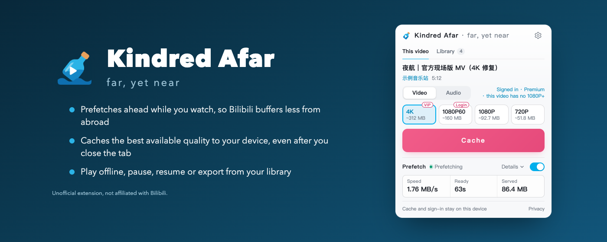
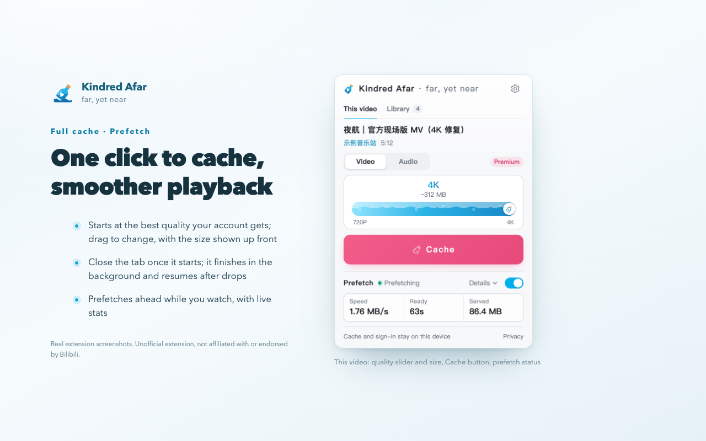
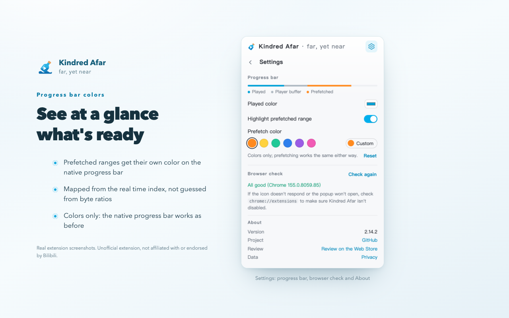
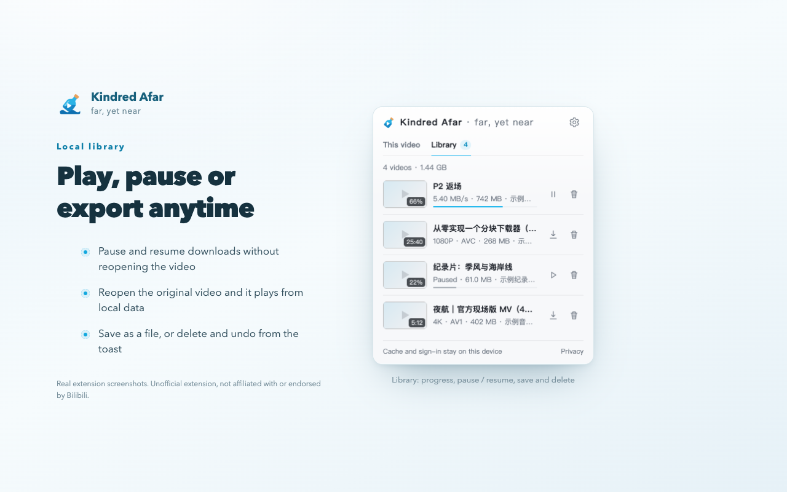
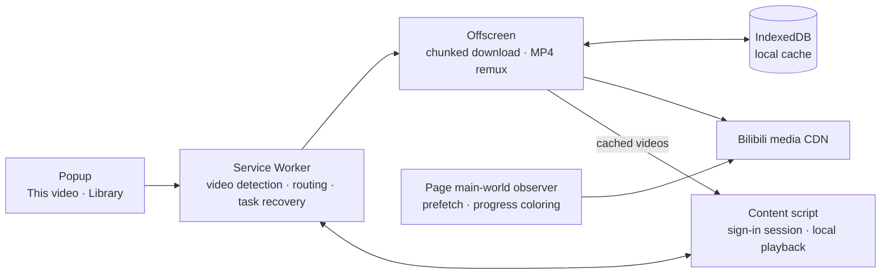

<div align="center">


# Kindred Afar

**English** · [简体中文](README.md)

*With a kindred spirit somewhere in the world, even the ends of the earth feel next door.*

A Chrome extension for watching Bilibili from outside mainland China: **prefetches ahead of playback to cut buffering, and caches full videos on your device for offline viewing**.<br>
It keeps Bilibili's own player, never re-encodes, has no server, and all data stays on your device.

[](https://chromewebstore.google.com/detail/bjegpandnhmeinmennpfpkholhmbllam)
[](https://chromewebstore.google.com/detail/bjegpandnhmeinmennpfpkholhmbllam)
[](https://github.com/Kihara-Ri/bilibili-buffer-extension/releases)

[](LICENSE)

[**Website**](https://haineicunzhi.kihara.cn/en/) · [**Add to Chrome**](https://chromewebstore.google.com/detail/bjegpandnhmeinmennpfpkholhmbllam) · [Privacy](https://haineicunzhi.kihara.cn/privacy.html) · [Tip the author](https://haineicunzhi.kihara.cn/en/#tip)

</div>



> [!NOTE]
> The interface follows Chrome's language: Chinese (Simplified or Traditional) shows Chinese, everything else shows English. In Chinese the extension is called **海内存知**, from the Tang poem line 「海内存知己，天涯若比邻」.

## Install

> [!TIP]
> **From the Chrome Web Store (recommended)**: open the [store page](https://chromewebstore.google.com/detail/bjegpandnhmeinmennpfpkholhmbllam) and click "Add to Chrome". Updates are automatic.

<details>
<summary>Install the zip manually (when the store version lags behind, or to try the latest changes)</summary>

1. Download `haineicunzhi-<version>.zip` from [Releases](https://github.com/Kihara-Ri/bilibili-buffer-extension/releases), or clone this repository.
2. Open `chrome://extensions/` and turn on "Developer mode" in the top right.
3. Drag the zip onto the page, or use "Load unpacked" and pick the repository folder.

> **Note**: a manually installed extension may be disabled after Chrome updates. If it "does nothing", first check `chrome://extensions` that it isn't disabled.

</details>

## What it does

Watching Bilibili from abroad usually means three headaches: constant buffering, auto quality dropping for no clear reason, and no good way to keep a video. Kindred Afar has an answer for each:

| | |
| --- | --- |
|  | **Keep it on your device, watch it offline**<br>Caches the best quality your account gets (AV1 / HEVC / AVC) and joins video and audio into one MP4 locally, without re-encoding. Close the video page once it starts; the extension finishes in the background and resumes after interruptions. Audio-only is also available (Hi-Res lossless first). Reopen a cached video and it switches to local playback, with danmaku and playback speed as usual. |
|  | **Prefetch while you watch, less buffering**<br>While playing, it fetches roughly the next 90 seconds ahead, so seeking doesn't mean waiting again; the prefetched part gets its own color on the progress bar. Slow nodes are swapped for backup addresses, and one slow sample can't drag auto quality down afterwards. |
|  | **One library for everything**<br>Every cache task lives in the Library: pause and resume without opening the original video; export or delete finished ones, with undo for deletes. If a Chrome update breaks something, the "Browser check" lists exactly what. |

> [!IMPORTANT]
> **Scope**: standard BV / av videos, multi-part videos and Watch Later pages. Bangumi and interactive videos are not supported yet. It cannot bypass Premium, paid or regional restrictions; everything follows what your account is actually entitled to.

<details>
<summary>How it works (for the curious)</summary>

- Prefetch: after the player's first media request, multiple Range chunks are pipelined in parallel to warm up the window ahead. When a player request is fully covered it's answered from local data; gaps are split and filled, reusing in-flight chunks.
- Slow or failed manifest routes can fall back to compatible mirrors after checking the original media prefix and total size; healthy routes do not trigger mirror probes. Language-prefixed video and list pages are supported.
- Progress bar coloring maps the real SIDX segment index onto the timeline instead of estimating from byte ratios.
- The in-page memory cache is capped at 128 MiB, with the window ahead capped separately at 96 MiB; turning the switch off cancels prefetching and cleans up.
- Full caching writes chunks in IndexedDB transactions and only counts progress once chunks are contiguously committed; expired playback addresses are refreshed and tasks resume automatically in the background.



The full design is in [技术文档.md](技术文档.md) (Chinese).

</details>

## Privacy

The Chrome extension has no server or telemetry. Its sign-in state is only used locally, and cookie values are never shown or stored. The separately enabled content service stores Bilibili credentials and content on the user’s own server; see its [architecture and data boundaries](server/content/ARCHITECTURE.md). See the [privacy policy](privacy.html) (English version at the end).

## Development

```bash
npm install        # first time
npm run dev        # hot reload: reloads the loaded extension and Bilibili pages about 1 second after a change
npm test           # unit and store-compliance tests
npm run check      # syntax check + Chrome version compatibility gate
npm run build      # builds dist/unpacked and dist/haineicunzhi-<version>.zip (with store checks)
npm run site:preview  # builds the website and previews it at http://127.0.0.1:4310 (npm run test:site runs browser checks)
npm run test:chrome  # downloads Chrome for Testing matching your local Chrome and runs all browser suites
npm run test:live    # online: loads the extension in real Chromium, caches a real Bilibili video and plays it
```

UI strings live in `src/locales/{zh-CN,en}.js`; `tests/i18n.test.mjs` checks the two tables stay in sync. Code comments and developer docs are in Chinese.

## License

[GPL-3.0](LICENSE). You may use, modify and redistribute it freely; redistributed versions based on this project must also be open-sourced under GPL-3.0. Notices for referenced projects are in [THIRD_PARTY_NOTICES.md](THIRD_PARTY_NOTICES.md).

Current version 2.16.0. History: [开发日志.md](开发日志.md) (Chinese) and [Releases](https://github.com/Kihara-Ri/bilibili-buffer-extension/releases). Issues and suggestions are welcome in [Issues](https://github.com/Kihara-Ri/bilibili-buffer-extension/issues), in English or Chinese.

### Release channels

The store edition updates through Chrome Web Store and provides a GitHub download link in Settings → About. For more frequent updates, download `haineicunzhi-github-<version>.zip`, extract it, and use Chrome Developer mode → Load unpacked. The first version containing the updater requires manual installation. These are separate installations; cached videos do not migrate automatically. Avoid enabling both copies together.

In the GitHub edition, choose Check GitHub updates and select the actual installation folder once. After checking, choose Update and reload and confirm write access when Chrome requests it. The extension verifies the signature, pauses tasks, backs up files, replaces them, reloads, and verifies the new background. Keep Developer mode enabled and the update page open during writes. Open Bilibili video pages refresh after a successful update unless unchecked. Use the recovery button after an interrupted update; if the extension cannot start, replace files in the original folder with a trusted ZIP and reload.

Publisher setup: [GitHub update maintenance](docs/development/github-updates.md) (Chinese).

## Standalone content API (development)

`server/content/` is a separate Python 3.11+ content-acquisition service with no third-party runtime dependencies. It exposes account/QR login, watch-later, URL and multipart resolution, timestamped subtitles, and short-lived MP4 streaming with byte-range support. It does not change the Chrome extension's player, downloader, UI, or permissions.

```bash
python3 server/content/run.py serve --port 8765
npm run test:content
```

No frontend, discovery ranking, or model calls are included. See the [API handoff](server/content/API.md). The Python process remains loopback-only; Nginx now exposes it at https://bilibili.kihara.cn on rasp5remote with trusted HTTPS and separate site authentication. A phone UI and iPhone playback acceptance are still pending. See the [project scope](server/content/PROJECT.md), [references](server/content/REFERENCES.md), and [module documentation index](server/content/README.md).
