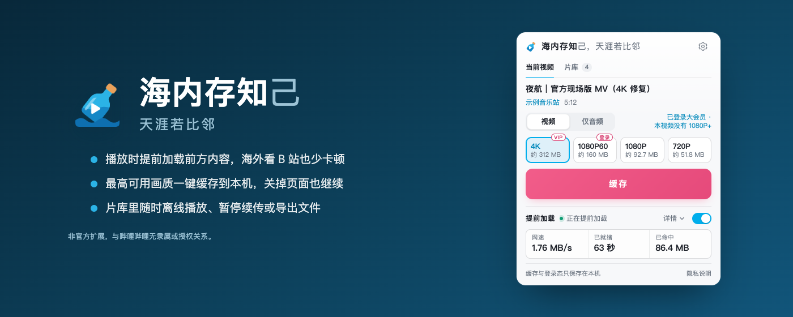
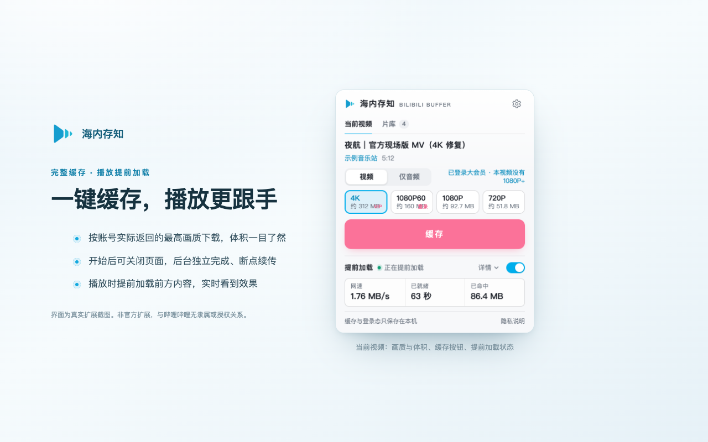
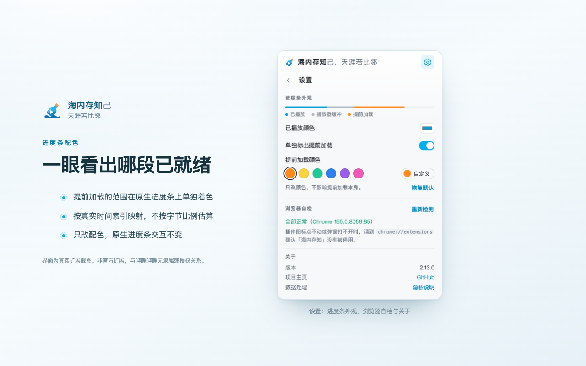
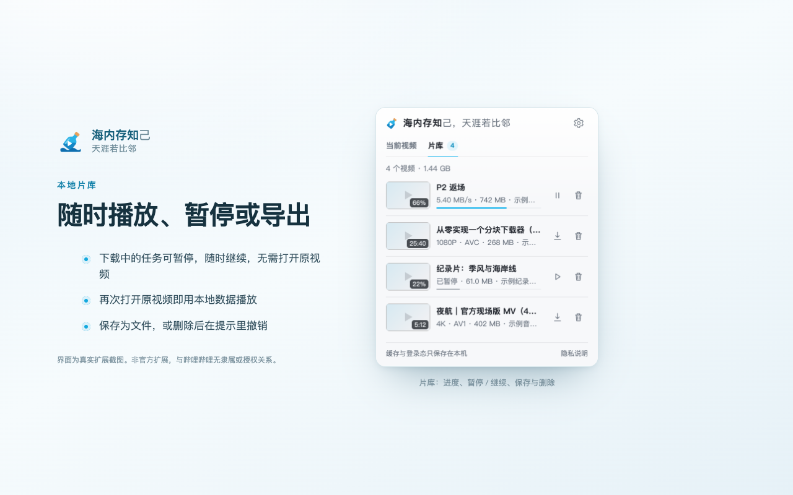
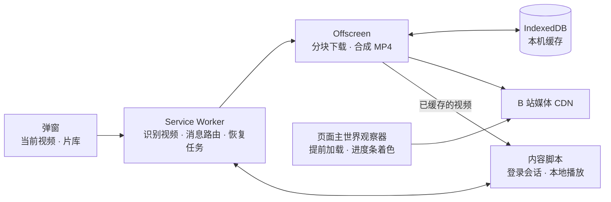

<div align="center">


# 海内存知

[English](README.en.md) · **简体中文**

**海内存知**己，天涯若比邻。

在海外看 B 站的 Chrome 扩展：**播放时提前加载、少转圈，也能把视频完整存到本机离线看**。<br>
沿用 B 站原生播放器，不转码、无服务器，数据全部留在本机。

<sub><i>English name: <b>Kindred Afar</b>. The extension follows Chrome's language, and there is an <a href="README.en.md">English README</a>.</i></sub>

[](https://chromewebstore.google.com/detail/bjegpandnhmeinmennpfpkholhmbllam)
[](https://chromewebstore.google.com/detail/bjegpandnhmeinmennpfpkholhmbllam)
[](https://github.com/Kihara-Ri/bilibili-buffer-extension/releases)

[](LICENSE)

[**官网**](https://haineicunzhi.kihara.cn) · [**添加到 Chrome**](https://chromewebstore.google.com/detail/bjegpandnhmeinmennpfpkholhmbllam) · [隐私说明](https://haineicunzhi.kihara.cn/privacy.html) · [English site](https://haineicunzhi.kihara.cn/en/) · [投喂作者](https://haineicunzhi.kihara.cn/#tip)

</div>



> [!NOTE]
> 界面跟随 Chrome 语言：中文（简繁）显示中文，其余显示英文（英文名 **Kindred Afar**）。

## 安装

> [!TIP]
> **从 Chrome 网上应用店安装（推荐）**：打开[商店页面](https://chromewebstore.google.com/detail/bjegpandnhmeinmennpfpkholhmbllam)，点「添加至 Chrome」。之后会自动更新。

<details>
<summary>手动安装 zip（商店版本还没跟上，或者想试最新改动时）</summary>

1. 下载 [Releases](https://github.com/Kihara-Ri/bilibili-buffer-extension/releases) 里的 `haineicunzhi-<version>.zip`，或克隆本仓库。
2. 打开 `chrome://extensions/`，开启右上角「开发者模式」。
3. 把 zip 直接拖进页面，或用「加载已解压的扩展程序」选择仓库目录。

> **注意**：手动安装的扩展可能在 Chrome 升级后被停用；插件「没反应」时，先到 `chrome://extensions` 确认它没有被停用。

</details>

## 它能做什么

在海外看 B 站，常见三个麻烦：播放频繁转圈、自动画质被莫名压低、想保存视频没有好办法。海内存知各给一条路：

| | |
| --- | --- |
|  | **存到本机，断网也能看**<br>默认保存播放器当前画质，也可指定账号可用的画质与编码。音视频在本机合成一个 MP4。手动缓存可以在关闭视频页后继续，也可以只存音频（Hi-Res 无损优先）。再打开已缓存的视频会自动切到本地播放，弹幕、倍速照常。 |
|  | **按播放余量提前加载**<br>根据播放器已缓冲的时长、倍速和网速补齐前方缺口。进度条灰色是普通缓冲，实心橙色是已进入播放器的插件缓冲，橙色斜线是待播放器取用的预取数据。节点慢时自动换备用地址，并按需尝试校验过的兼容镜像。 |
|  | **片库统一管理**<br>在「片库」里暂停、继续、导出或删除缓存。已完成的单文件可点播放按钮，在断网时打开 Chrome 原生媒体页。删错了能撤销。Chrome 升级后可通过「浏览器自检」查看具体的能力问题。 |

> [!IMPORTANT]
> **适用范围**：标准 BV / av 投稿、分 P 与稍后再看页（含语言前缀页面）；番剧、互动视频等暂不支持。不能绕过大会员、付费或地区限制，一切以当前账号的实际权益为准。

进页默认使用「自适应」缓冲。想保存当前视频，可在弹窗点「缓存」，同时继续观看。默认保存播放器当前画质，也可在主界面指定画质或仅音频，在 **设置 → 缓冲策略 → 缓存编码** 指定视频编码。在 **设置 → 缓冲策略 → 进页默认** 选「全速缓冲」，则每次打开视频都按播放器当前画质自动缓存整片，播放稳定时使用可用的下载额度。扩展图标显示缓存进度，进度条上的**橙色圆点**表示音画都已落盘、可按需从本地读出的区间。视频缓存完成后，播放器自动从当前位置切到本地播放。

<details>
<summary>实现要点（给好奇的人）</summary>

- 提前加载：拿到播放器首个媒体请求后，多个 Range 分片并行流水线预热前方窗口；播放器请求完整命中时直接用本机数据回应，缺口拆片补齐并复用在途分片。
- 进度条按 `video.buffered` 绘制实际缓冲区间，预取提示按 SIDX 真实分段索引定位。
- 稳定播放时，播放器可提前接收连续驻留的音视频分段。双轨追加后，对应的斜线会变成实色，保留插件的缓冲颜色。
- 页面内存缓存驻留上限 128 MiB，前方窗口另按 96 MiB 封顶；关闭开关即取消预热并清理。
- 完整缓存分块写入 IndexedDB 事务，连续提交后才计入进度；播放地址失效自动刷新，后台自动恢复。



完整设计见 [技术文档.md](技术文档.md)。

</details>

## AI 下载工具

源码提供本地 MCP。连接平时使用的 Chrome 后，AI 可沿用该资料里的 B 站登录和扩展片库，查询分 P、画质与体积，按预算批量下载音视频及字幕。任务和导出路径可跨会话查询。 [接入与调用说明](docs/development/bilibili-mcp.md)

## 隐私

Chrome 扩展本身没有服务器或遥测，登录态只在本机使用，Cookie 原文从不展示或保存。下述独立内容服务是用户自行启用的另一条运行路径，会在用户自己的服务器保存 B 站登录态和内容数据，具体边界见[内容服务架构](server/content/ARCHITECTURE.md)。详见[隐私说明](privacy.html)。

## 开发

```bash
npm install        # 首次
npm run dev        # 热更新：修改代码约 1 秒内自动重载已加载的扩展与 B 站页面
npm test           # 单元与上架合规测试
npm run check      # 语法检查 + Chrome 版本兼容门禁
npm run build      # 生成 dist/unpacked 与 dist/haineicunzhi-<version>.zip（含上架体检）
npm run site:preview  # 构建官网并在 http://127.0.0.1:4310 预览（npm run test:site 做浏览器检查）
npm run test:chrome  # 下载与本机 Chrome 同版本的 Chrome for Testing，跑全部浏览器套件
npm run test:live    # 联网：真实 Chromium 加载扩展，对真实 B 站视频跑完整缓存并播放结果
```

> [!NOTE]
> 在 WSL 里开发时请安装 **Linux 版 Node（≥ 22.2）** 再用 npm。Windows 版 npm 通过 `cmd.exe` 执行脚本，而 `cmd.exe` 不支持 `\\wsl.localhost\...` 作为工作目录，会静默退回 `C:\Windows`；`npm test` 因此会直接报「找不到 scripts/run-tests.mjs」。暂时只有 Windows 版 Node 时，可以绕过 npm 直接运行脚本，例如 `node.exe scripts/run-tests.mjs`。

## 许可证

[GPL-3.0](LICENSE)。可以自由使用、修改和再分发；基于本项目再发布的版本也须以 GPL-3.0 开源。参考项目的许可声明见 [THIRD_PARTY_NOTICES.md](THIRD_PARTY_NOTICES.md)。

## 文档

- [技术文档.md](技术文档.md) — 架构、消息契约、存储、权限、术语与已知边界；**想了解实现细节从这里进**
- [docs/](docs/README.md) — 专题文档索引：现状（完整缓存、提前加载、弹窗等）、开发（构建、测试、浏览器兼容）与冻结的历史记录
- [开发日志.md](开发日志.md) — 每个版本改了什么、为什么、怎么验证
- [THIRD_PARTY_NOTICES.md](THIRD_PARTY_NOTICES.md) — 参考项目与许可声明
- [store/](store/) — Chrome Web Store 提审资料

当前版本 2.17.0。版本历史见[开发日志](开发日志.md)与 [Releases](https://github.com/Kihara-Ri/bilibili-buffer-extension/releases)。问题与建议请提 [Issue](https://github.com/Kihara-Ri/bilibili-buffer-extension/issues)。

### 两个发布渠道

商店版使用 Chrome 商店更新；设置 → 关于 →「下载 GitHub 版」可打开 GitHub Releases。GitHub 版更新更频繁，下载 `haineicunzhi-github-<版本>.zip` 后解压，并以开发者模式「加载已解压的扩展程序」。首次获得更新器仍需手动安装此版本。两种安装相互独立，本地缓存不会自动迁移；不要同时启用两份。

GitHub 版设置中点「检查 GitHub 更新」，首次选择实际安装目录。检查新版本后点「更新并重载」，按 Chrome 提示确认写入权限，随后自动验证签名、暂停任务、备份、替换、重载及检查新后台。保持开发者模式开启；更新成功后默认刷新 B 站视频页，可取消勾选。写入未完成时勿关闭更新页。出错时可从同一入口恢复旧文件；若扩展已无法启动，下载可信 ZIP 覆盖原目录并重新加载，保留原安装与缓存。

发布者配置与验证见 [GitHub 更新维护说明](docs/development/github-updates.md)。

## 独立内容读取接口（开发中）

仓库另提供 `server/content/`：Python 3.11+、零运行时第三方依赖的本机内容引擎，可供独立网页或手机前端调用。它与上面的 Chrome 扩展分开运行，不改扩展的原生播放器、下载链路或权限。

```bash
python3 server/content/run.py serve --port 8765
npm run test:content
```

接口覆盖账号状态／扫码登录、稍后再看、视频 URL 与分 P 解析、字幕时间段、短期 MP4 播放及 Range 转发。**不包含 UI、控件、发现算法或 AI 审阅**；完整的前端接入说明见 [内容引擎 API](server/content/API.md)。服务进程只监听回环地址；已在 rasp5remote 通过 Nginx、正式 HTTPS 和站点认证部署到 `https://bilibili.kihara.cn`，尚无手机 UI 或 iPhone 播放验收。目标、约束、参考项目与路线见[项目说明](server/content/PROJECT.md)，完整文档从[模块入口](server/content/README.md)读取。
