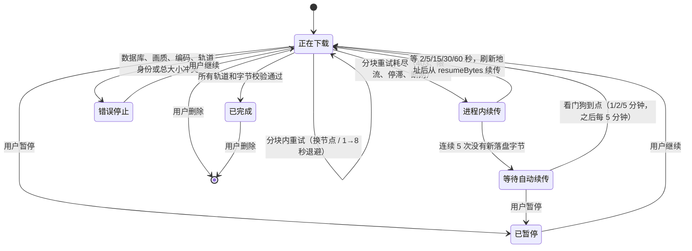

# 完整缓存（离线片库）

> 适用版本：v2.14.3 · 最后核对：2026-10-25
> 对应实现：`src/background.js`（识别与取地址）、`src/offscreen.js`（下载、合并、本地播放）、
> `src/range-downloader.js`、`src/download-retry.js`、`src/db.js`、`src/mp4-merge.js`、
> `src/media-selection.js`、`src/utils.js`、`src/content.js`。

完整缓存把当前账号可访问的媒体轨原样下载进扩展的 IndexedDB，之后可以在原 B 站播放器里本地播放，或保存成文件。它与在线「提前加载」完全独立，两者的区别见[技术文档 · 四种缓存](../../技术文档.md#11-四种缓存)。

## 1. 识别视频

### 1.1 支持的页面

- `/video/BV…`、`/video/av…`；
- 带 `bvid` 参数的 `/list/…`（稍后再看、合集列表）；
- `?p=N` 分 P。

番剧、互动视频、课程和其他特殊格式不在支持范围。

### 1.2 视频信息

后台请求 `/x/web-interface/wbi/view` 取得 BVID、CID、标题、UP 主、封面、时长和分 P。老接口 `/x/web-interface/view` 对不带网页指纹的请求（扩展后台、自动化浏览器）稳定返回 HTTP 412，只作回退。

- **BVID**：一个投稿的公开编号；
- **CID**：投稿里某一个分 P 的实际内容编号。

缓存身份必须包含 CID，否则不同分 P 会互相覆盖。

### 1.3 播放清单与登录态

播放清单来自 `/x/player/playurl`，按以下顺序获取：

1. 后台向当前 B 站标签页发送 `BILI_BUFFER_FETCH_PLAYURL`，由页面以 `credentials: "include"` 请求，浏览器自动带上登录 Cookie；
2. 页面不存在或不响应时，后台直接用当前 Chrome 的 B 站会话请求。

扩展通过 Cookies API 只检查 `SESSDATA` 是否存在，不展示、复制或保存 Cookie 原文。会员与付费权限以接口实际返回的轨道为准，插件不会绕过账号权限。

## 2. 选择轨道

### 2.1 画质

插件请求最高画质代码，但不直接相信 `accept_quality` 的声明：

1. 遍历 `dash.video`，只保留带 URL、MP4 MIME 和 codec 的轨道；
2. progressive 路线只接受单段 MP4（`durl` 只有一段）；
3. 按画质代码降序排列，第一项为默认画质。

所以「最高画质」指当前账号、当前视频、当前响应里**真正存在且能处理**的最高档。

弹窗把两个概念分开：

| 概念 | 来源 | 函数 |
| --- | --- | --- |
| B 站声明可用 | `accept_quality` / `accept_description` / `support_formats`，含当前账号拿不到的档位 | `buildQualityOptions`，随快照存为 `cacheSizeInfo.declared` |
| 当前账号返回 | `dash.video` 里真正带 URL 与 codec 的轨道，即画质滑杆上可选的档位 | `buildMediaQualityOptions` |

声明里有未返回的档位时，画质滑杆与账号说明的悬停提示同时列出「声明可用 / 当前账号返回」；当前账号因登录或大会员拿不到的更高档位画在杆尾的锁定段。如果返回的最高档就是声明的最高档，说明已经拿到当前账号能拿到的最高规格；体积小通常是画面码率低（静态画面），而不是档位不够。

### 2.2 编码

可选：自动（省流）、AV1、HEVC/H.265、AVC/H.264。

- **自动**只在所选画质内挑选：先排除 `MediaSource.isTypeSupported` 不支持的轨道，再按声明的 `bandwidth` 从低到高选；码率相同时按 AV1 → HEVC → AVC。
- **显式选择**某种编码时，缺失或不支持就明确报错，不悄悄换成别的编码。

### 2.3 音频

两种缓存内容的音轨优先级不同（`src/media-selection.js` 的 `chooseAudioRepresentation`）：

| 缓存内容 | 候选来源 | 优先级 | 理由 |
| --- | --- | --- | --- |
| 视频 + 音频 | `dash.audio`、`dash.dolby.audio`、`dash.flac.audio` | AAC（同族取最高码率）> FLAC > 杜比 > 其他 | 要与视频合成单个 MP4，优先兼容性 |
| 仅音频 | 同上 | Hi-Res 无损（30251 `fLaC`）> 杜比全景声 > AAC（最高码率）> 其他 | 只保存音频，优先音质 |

两种模式都先排除当前浏览器不支持的编码。例如 macOS 无头 Chrome 不支持 `ec-3`，杜比轨会被跳过、落到 AAC；`audio/mp4; codecs="fLaC"` 在 Chrome 中受支持，所以 Hi-Res 无损可以选中。插件不转码，也不把音频统一转成 MP3。

播放清单里没有独立音轨（只有 `durl` 单段 MP4）时，「仅音频」不会失败，而是走[第 6 节](#6-从单文件-mp4-提取音轨)的提取路线。

**关于 `.flac`**：B 站 Hi-Res 无损的原始文件就是 **MP4 容器 + FLAC 编码**（CDN 上的 `_30251.m4s`，`audio/mp4` + `codecs: "fLaC"`）。插件按编码把文件命名为 `.flac`（与 B 站客户端「无损」的命名习惯一致），字节与 CDN 完全相同，所以播放器把它识别成 MP4 容器是准确的。片库保存按钮的悬停提示用 `describeAudioContainer` 写出「容器 · 编码」。去掉 MP4 封装的「原生 FLAC 流」需要改写容器，目前不做：它改变了 B 站交付的原始容器，手上也没有足够的真实样本验证。

## 3. 任务

### 3.1 身份与键

```text
任务身份 = BVID + CID + 缓存内容（视频+音频 / 仅音频）+ 画质 + 编码选择
视频缓存键 = <页 ID>:q<画质>[:c<编码>]
仅音频键   = <页 ID>:a
```

不同分 P、画质、编码和两种缓存内容可以共存。没有编码后缀、没有缓存模式字段的旧记录按视频缓存读取。弹窗里「视频 / 仅音频」的选择是用户偏好，存在 `chrome.storage.local["cacheModeV1"]`，不属于单个视频。

### 3.2 媒体来源

优先 DASH，每个任务只下载需要的轨道：

- 视频 + 音频：一条视频轨 + 一条音频轨；
- 仅音频：一条音频轨；
- 每条轨道带一个主 CDN 地址和若干备用地址。

接口只返回单段 MP4 时走 progressive 路线：「视频 + 音频」整体保存，「仅音频」下载后提取音轨。

### 3.3 IndexedDB

数据库 `bili-buffer-cache`，版本 1：

| 对象仓库 | 内容 |
| --- | --- |
| `videos` | 任务元数据：状态、画质、编码、总大小、断点、统计 |
| `chunks` | 媒体分块 Blob，复合主键 `[videoId, track, index]`；`track` 为 `video` / `audio` / `media` / `merged` |

扩展 ID 由 `manifest.json` 的 `key` 固定，IndexedDB 归属于这个 ID，所以热更新和重载不会删除片库。卸载扩展或清除扩展存储会删除片库。

## 4. 下载

### 4.1 节点测速

正式下载前，从主地址和最多两个备用地址各读 64 KiB：

- 最多等 8 秒，只接受 HTTP 206；
- 校验范围与媒体总大小；
- 按端到端有效读取速度排序；
- 响应启动延迟与正文吞吐分开记录，供后续排序使用。

### 4.2 Range 分块并发

媒体按 2 MiB 切块（`DEFAULT_RANGE_SIZE`）：

| 参数 | 值 | 位置 |
| --- | --- | --- |
| 视频轨（或 progressive MP4）并发 | 6 | `DEFAULT_RANGE_CONCURRENCY` |
| 音频轨并发（与视频并行时） | 2 | `offscreen.js` 的 `trackConcurrency` |
| 每轨乱序窗口 | 16 MiB（含在途、乱序完成、待提交） | `downloadByteRanges` 的 `maxBufferedBytes` |
| 停滞超时 | 首字节或正文连续 20 秒没有新字节 | `DEFAULT_RANGE_TIMEOUT` |
| 队头对冲 | 队头分块在途 ≥ max(2 秒, 正常分块耗时中位数 × 3) 时重复请求一次；同时至多 2 路 | `DEFAULT_HEDGE_AFTER_MS`、`MAX_HEDGES_IN_FLIGHT` |
| 每块最多尝试 | 6 次 | `DEFAULT_RANGE_ATTEMPTS` |

- **只按停滞判超时，不设总时长**：海外单连接常只有几十 KB/s，2 MiB 正常也可能要一分钟。
- **队头对冲**：分块只能按序落盘，最前面那块卡在一条「涓流但不停滞」的连接上时，后面的块下完也只能在窗口里干等：界面速度还在跳、百分比不动，停滞超时又永远不触发（真实 B 站 1 小时视频复现过 12 秒零落盘、0.17 MB/s）。现在空闲工作者不再干等，而是对队头分块再发一次请求，优先换到另一个节点，只有一个节点时用同一地址的新连接；先拿到完整正文的一方胜出，另一方立即取消并回滚已收字节，也会被记一次失败，参与后续节点排序。对冲次数记在 `hedgeCount` / `hedgeWins`。
- **分块内消化故障**：每次尝试前按实时成绩重排候选，失败多的地址排后；有别的地址就立刻换，只剩同一地址时按 1 → 2 → 4 → 8 秒退避。
- **403** 表示这个签名地址被拒，从本块候选中剔除；所有地址都被拒才向上抛，由任务刷新播放地址。

扩展自己发往媒体 CDN 和 `api.bilibili.com` 的请求，由 Declarative Net Request 补上 `Referer: https://www.bilibili.com/`，否则 CDN 会因缺少防盗链来源返回 403、接口会被风控拒绝。规则用 `initiatorDomains` 限定为本扩展的开发 ID 与商店 ID，不影响任何网页自己的请求（见[构建与发布 · 扩展 ID](../development/build-and-release.md#31-扩展-id-必须与-dnr-规则一致)）。CDN 正文请求用 `credentials: "omit"`，不向 CDN 发送 B 站 Cookie。

### 4.3 每块必须满足的校验

```text
HTTP 206 Partial Content
Content-Range: bytes 2097152-4194303/9437321
```

- 状态为 206；
- 返回起点 = 请求起点，返回终点 = 请求终点；
- 总大小与任务一致；
- 实收正文长度 = 声明长度。

任何一项不满足，这一块都不会提交。

### 4.4 连续提交与三种水位

并发请求会乱序完成，后面的块先到也不能越过前面的缺口推进断点。协调器只把从当前水位开始**连续**的一批块，与新断点一起写进同一个 IndexedDB 事务：全部成功才生效，任一失败整体回滚。

| 字段 | 含义 | 对外展示 |
| --- | --- | --- |
| `downloadedBytes` | 已接收字节，可能含重试时丢弃的在途数据 | 不当成「已缓存」 |
| `resumeBytes` | 数据库里连续、完整的安全断点；事务进行中可暂存下一断点 | 崩溃、热更新、断网后只从这里恢复 |
| `committedBytes` | 事务完成后才提高的确认水位 | 弹窗的「已缓存」和下载进度以它为准；旧记录回退到 `resumeBytes` |
| `createdAt` | 任务创建顺序 | 片库排序 |
| `runStartedAt` | 下载世代，区分旧快照与真正的重新下载 | — |
| `updatedAt` | 只参与新旧比较 | 不决定行位置 |

### 4.5 故障恢复

故障分三层消化，越靠内越快：

1. **分块内**（`range-downloader.js`）：换节点或退避重试，见 4.2。绝大多数链路抖动在这里解决，任务不中断。
2. **任务内**（`offscreen.js` 的 `downloadVideo`）：分块重试耗尽后，在 Offscreen 里依次等 2、5、15、30、60 秒，每次都刷新播放地址再从 `resumeBytes` 续传。两次失败之间只要有新字节落盘，计数就清零，长视频不会因为累计的偶发故障停下。
3. **看门狗**（`download-retry.js` + `chrome.alarms`）：连续 5 次零推进（约两分钟真正断网）后，写入 `nextRetryAt` 交给看门狗。等待间隔为 1 分钟、2 分钟、5 分钟，之后**一直按 5 分钟重试，不设次数上限**——长时间断网恢复后仍能自动续上。看门狗每分钟巡视一次，跳过仍由 Offscreen 正常处理的任务；浏览器重启后也由它恢复。

可自动恢复的错误：HTTP 403、408、425、429、5xx；`Failed to fetch` 等网络中断；超时；正文提前结束；CDN 地址耗尽或签名失效。

不自动恢复、直接停在错误状态的情况：IndexedDB 事务失败；画质或编码身份冲突；DASH 轨道身份变化；媒体总大小不一致；Range 起点错误。



### 4.6 暂停与继续

- **暂停**（`PAUSE_CACHE`）：Offscreen 中止该任务的在途请求，等任务完全收尾后写入 `status: "paused"` 并广播 `CACHE_PAUSED`。看门狗只恢复 `downloading` 的任务，不会拉起已暂停的任务。合并、抽取音轨这类收尾阶段不响应中止：暂停晚于最后一块时任务直接完成，`PAUSE_DOWNLOAD` 按真实结果回报。
- **继续**（`RESUME_CACHE`）：后台用记录里的 bvid / cid / 画质重新请求播放地址（取不到时退回记录里保存的地址），与看门狗恢复共用 `restartDownload`。旧任务仍在收尾时，新的 `START_DOWNLOAD` 会等它注销后再启动，而不是被当成重复启动忽略。

- **删除**（`DELETE_VIDEO`）：先中止在途任务并**等它完全收尾**，再删除记录与分块。收尾阶段还会写库（进行中的分块事务、失败路径的安全水位快照），先删后收尾会让记录带着旧水位复活，下次缓存从删除前的位置「续传」而前面的分块已经不在（2.14.1 修复）。删除返回后立刻重新缓存会从 0 开始。

关闭弹窗和原视频页都不影响下载：下载在 Offscreen 里进行，Referer 由 DNR 补；需要刷新地址时，后台在视频页已关闭的情况下直接用 Chrome 的 B 站会话请求，取得同画质、同编码的新地址后从 `resumeBytes` 续传。

### 4.7 完成判定

- **progressive 与仅音频**：每块完整，实收字节 = 总大小（仅音频还要求 `tracks.audio` 记录同一水位）。
- **视频 + 音频**：两条轨道都完整后再合并，并满足 `merged.totalBytes > 0`、`merged.downloadedBytes === merged.totalBytes`、合并结果通过初始化段自检。

合并失败不会伪造完成：记录保留两条独立轨道并按双轨判定完成，同时写入 `mergeError`，界面提示「未能合并为单个 MP4」。HTTP 403 且零字节的错误任务不会进入已缓存片库。

## 5. 双轨合并为单个 MP4

对应 `src/mp4-merge.js`。B 站高画质返回两条独立的 fragmented MP4（`ftyp + free + moov(mvex) + sidx + moof/mdat …`），合并是**重封装**而不是转码：

1. 从两条轨道各读初始化段，取出 `mvhd`、`trak`、`mvex`；
2. 合并 `ftyp` 的主品牌与兼容品牌；
3. 生成新的 `moov`：视频轨固定为 `track_ID 1`、音频轨为 `track_ID 2`，同步改写 `tkhd`、`trex`、`trep`；`mvhd` 时长取两轨较大值，`next_track_ID` 改为 3；
4. 逐片段读取，用 `tfdt` 的解码时间（除以各自 `mdhd` 的 timescale）双路归并、按时间交错输出；最后一个 `mdat` 之后的 `sidx`、`mfra`、`free` 被丢弃，因为它们引用原文件的字节偏移；
5. 每个 `moof` 只改写 `tfhd` 的 `track_ID` 和 `mfhd` 的序号；`trun` 的 `data_offset` 以 moof 起点计算，整段复制后仍然有效；
6. 输出以 4 MiB 分块写回 `merged` 轨道，写完读回开头自检（`ftyp`、双轨 `moov`、轨道编号），通过后才删除 `video` / `audio` 分块。

内存占用只与单个片段有关：读取用分块内随机访问，任意时刻只驻留当前片段和一个输出缓冲。非 fragmented MP4、缺少 `mvex`、片段截断或出现无法识别的顶层盒子时抛出 `Mp4MergeError`，记录保留双轨，而不是写出不能播放的文件。旧版本留下的双轨缓存在本地播放或保存时走同一流程自动升级，不需要重新下载。

## 6. 从单文件 MP4 提取音轨

对应 `src/mp4-merge.js` 的 `createAudioOnlyMp4`。B 站只返回单段 MP4（`durl`）时，音视频混在一个文件里，「仅音频」要自己抽出音轨。效果等价于 `ffmpeg -i in.mp4 -vn -c:a copy out.m4a`，不重新编码任何样本：

1. 解析 `moov`，找到 `hdlr` 为 `soun` 的 `trak`，取出 `stsd`、`stsz`、`stsc` 与 `stco` / `co64`；
2. 按 `stsc` × `stsz` 展开每个分块的字节长度，与 `stsz` 的样本总字节交叉校验，不一致就拒绝输出；
3. 生成单轨 `moov`（`track_ID` 改为 1、`next_track_ID` 改为 2），把偏移表改成紧凑布局；
4. 输出 `ftyp + moov + mdat`，`mdat` 只放音频样本；源文件音视频交错，逐块小读会很慢，所以用 4 MiB 预读窗口顺序读取；
5. 写回后读回开头校验（`ftyp`、单轨 `moov`、`audio` 轨且 `track_ID` 为 1），通过后才释放整段 `media` 分块；
6. fragmented MP4 走分支路线：只保留音频轨的 `moof/mdat`，`track_ID` 改为 1；这类初始化段常没有 `stsz`，采样描述用宽松模式解析。

视频样本被丢弃，结果通常只有源文件的几分之一（实测 19 秒 360P：402 602 → 163 938 字节）。代价是这一次下载的流量等于整段 MP4——B 站不为这种文件提供音频分段，任何工具都只能先取整段。

## 7. 本地播放

页面打开或收到 `CACHE_READY` 后：

1. 内容脚本发送 `GET_CACHED_FOR_URL`，后台按当前页 ID（BVID + CID）找已完成、字节完整的记录，**排除仅音频记录**（避免把播放器变成没有画面的音频），按画质再按完成时间取最高的一条；
2. 内容脚本发送 `GET_PLAYBACK_URL`，Offscreen 读取并校验全部分块：
   - 已合并或可合并的视频缓存返回单个 MP4 的 Blob URL；
   - progressive 直接合成一个 MP4 Blob；
   - 只有合并不可用（`mergeError`）时才回退到双轨：把两轨读成 ArrayBuffer，建 MediaSource 和两个 SourceBuffer 整轨追加；
3. 用生成的 URL 替换原 `<video>` 的播放源，恢复播放位置、暂停状态、音量和倍速；
4. 发送 `PLAYBACK_ACTIVE`，工具栏徽标显示「本地」。

复用原 `<video>` 能保留 B 站控制条、弹幕时间轴和倍速。双轨回退要把完整媒体重新组合进页面内存，高画质长视频会有较大的临时内存开销。

## 8. 保存文件

保存前再次校验完整性，文件名按缓存内容决定：

| 缓存内容 | 保存结果 |
| --- | --- |
| 视频 + 音频 | 一个合并后的 `.mp4`；此前合并失败的记录分别保存「视频轨 .mp4」和「音频轨 .m4a」 |
| 仅音频 | 一个音频文件，扩展名按容器与编码推导：`fLaC` → `.flac`，AAC / 杜比 → `.m4a`，MP3 → `.mp3`；从单文件提取的通常是 `.m4a` |
| progressive | 一个 `.mp4` |

重封装全部在浏览器里由 `src/mp4-merge.js` 完成，不调用外部工具或转码器；`chrome.downloads` 只负责把 Blob 存成文件。

## 9. 验证

| 覆盖 | 位置 |
| --- | --- |
| 分块、校验、停滞、退避、403 剔除、队头对冲 | `tests/range-downloader.test.mjs` |
| 可恢复错误分类、看门狗间隔 | `tests/download-retry.test.mjs` |
| 确认水位不提前发布 | `tests/download-watermark.test.mjs` |
| 乱序窗口与背压 | `tests/download-memory.test.mjs` |
| 重封装、音轨提取 | `tests/mp4-merge.test.mjs`、`tests/mp4-audio.test.mjs` |
| 音视频轨选择 | `tests/media-selection.test.mjs`、`tests/utils.test.mjs` |
| 真实浏览器整链：下载 → 合并 → 播放、仅音频、旧双轨升级 | `tests/offscreen-merge-integration.mjs`、`tests/offscreen-integration.mjs`（`npm run test:popup` 内执行） |
| 真实 B 站视频联网缓存并播放 | `npm run test:live` |

浏览器整链测试使用 `tests/fixtures/` 里的真实 B 站 DASH 分片夹具（来源见 [tests/fixtures/README.md](../../tests/fixtures/README.md)）。
