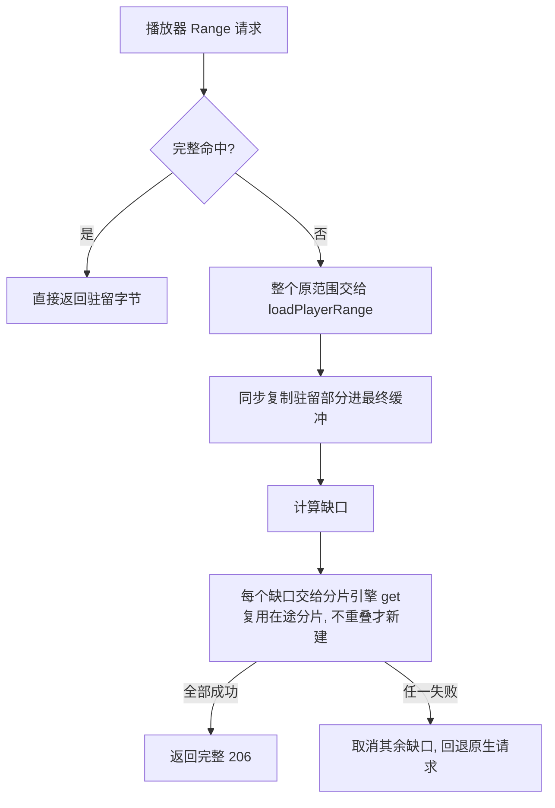

# 部分命中复用：只补缺口，拼出完整响应

> 适用版本：v2.12.6 · 最后核对：2026-10-24
> 对应实现：`src/playback-cache.js` 的请求适配器、`src/playback-observer.js` 的 `loadPlayerRange` / `assembleRange`、
> `src/playback-network.js` 的 `get`。整体链路见[播放提前加载](playback-assist.md)。
> 这项能力在 2.8.3 引入（缺口规划在缓存模块里），2.9.0 改成现在的结构，变化见开发日志对应版本。

## 1. 要解决的问题

预热按 512 KiB 分片写入，播放器的请求范围却常常和分片错位：

```text
驻留：     [0, 1 MiB) + [2 MiB, 3 MiB)
播放器请求：bytes=0-3145727（0 ~ 3 MiB）
```

如果只认「完整覆盖」，这个请求就要整段 3 MiB 重新下载，已经缓存的 2 MiB 白白浪费。目标是：**范围内已有的字节直接用，只下载缺口，再拼成一条完整、经过校验的 206 响应。**

## 2. 流程



1. **适配器**（`playback-cache.js`）：fetch / XHR 只要是单段 `bytes=a-b` 或 `bytes=a-` 且没有完整命中，就把**整个原范围**交给 `loadPlayerRange`；它返回空或抛错时交还原生请求。
2. **`loadPlayerRange`**：检查开关、页面世代和范围（单次最多 16 MiB，不超过已知总长），先尝试[离线镜像](persistent-range-reuse.md)，未命中再调用 `assembleRange`。
3. **`assembleRange`**：
   - 先检查是否已取消（在复用查询的 `await` 期间被取消的请求不会再派发 abort 事件）；
   - 一次性分配最终缓冲 `body`，用 `cache.copy` 把每段驻留字节**同步复制**进去；
   - 用 `missingRanges` 算出缺口，每个缺口调用 `network.get(url, from, to, { into: body, at })`，分片引擎直接把字节写到对应偏移，不经中间缓冲；
   - 所有缺口的文件总长必须与驻留数据一致，否则抛错。

## 3. 关键约束

### 3.1 复制快照，不持有视图

驻留部分在发起缺口下载**之前**就复制进最终缓冲。缺口下载是异步的，这期间容量回收、总长变化或条目替换都可能移除驻留块；复制让「已经规划好的内容」与缓存生命周期解耦。

### 3.2 只请求缺口，复用在途分片

缺口进入分片引擎后按急需请求处理：覆盖到正在下载的后台分片就等待并复用它，只为真正没人下载的部分新建分片。网络上看到的只有缺口，没有重复下载。

### 3.3 不交付半成品

任一缺口最终失败、长度不符或总长不一致，就取消其余缺口，整条请求回退原生——**不存在「先交付半条响应、稍后再补」**。取消或导航后不写入缓存、不交付旧字节，也不回退原请求。

### 3.4 内存

单个播放器请求的临时内存约为一份范围大小（最多 16 MiB）：驻留快照和缺口正文都直接写进同一个最终缓冲。

## 4. 计数

- 完整命中记在缓存的 `hits` / `hitBytes`。
- 经 `loadPlayerRange` 完成的请求属于网络下载，不算完整命中；其中复用的驻留字节（`reused`）单独记为 `partialHits` / `partialHitBytes`。
- 页面统计的 `cacheHits` / `cacheHitMB` 是两者之和，底层两类计数互不污染。

## 5. 边界

| 情况 | 行为 |
| --- | --- |
| 完整覆盖 | 适配器直接返回，不进入 `loadPlayerRange` |
| 部分覆盖 | 只下载缺口，拼成完整 206 |
| 无任何驻留 | 整个范围交给分片引擎，拆约 16 片并行 |
| 超过 16 MiB、超过已知总长、多范围或后缀范围 | 交还原生请求 |
| 缺口失败 / 总长不一致 | 整条回退原生，不返回半成品 |
| 请求取消 / 页面切换 | 不交付旧字节、不回退原请求 |
| 提前加载已关闭 | `loadPlayerRange` 返回空，全部走原生 |

不跨签名 URL、CDN 主机或清晰度复用正文，键始终是完整 URL。

## 6. 验证

`tests/playback-partial-cache.test.mjs`（Node VM，不启动浏览器、不访问 B 站）：

- fetch / XHR 只请求缺口并返回完整拼接正文；
- 缺口下载期间发生回收，不污染已复制的驻留字节；
- 缺口失败、总长不一致时整体回退；
- 取消与页面世代保护；
- 真实观察器 + 分片引擎整链只发出缺口 Range。

```bash
npm test
```
