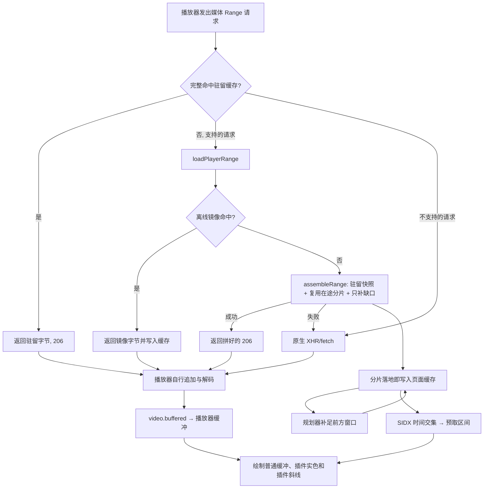

# 播放提前加载（在线）

> 适用版本：v2.16.1 工作树 · 最后核对：2026-11-22
> 对应实现：`src/playback-cache.js`、`src/playback-network.js`、`src/playback-reuse.js`、
> `src/playback-observer.js`（以上为 MAIN world，按此顺序注入）、`src/playback-bridge.js`（ISOLATED world）。

「提前加载」在用户观看时把播放器前方的分段先取回页面内存，再用驻留数据回应播放器的 XHR / fetch 请求。稳态下，插件可短暂提高 B 站 DASH 播放器的前向缓冲目标，让它提前请求并追加已经驻留的音视频分段。播放器仍负责媒体分段的追加和解码。

相关专题：

- [部分命中复用](partial-cache-reuse.md)：请求只有一部分在缓存里时怎么拼；
- [播放位置感知回收](playback-retention.md)：128 MiB 满了先丢哪些；
- [持久化源范围复用](persistent-range-reuse.md)：离线下载过的字节怎样服务在线播放；
- [下载工作内存](download-memory.md)：各环节的字节上限。

## 1. 模块与执行路径

| 文件 | 世界 | 职责 |
| --- | --- | --- |
| `playback-cache.js` | MAIN | 驻留字节、范围匹配、SIDX 与轨道类型解析、fetch / XHR 适配器 |
| `playback-network.js` | MAIN | 分片引擎：在途表、槽位、对冲、节点健康度 |
| `playback-reuse.js` | MAIN | 经隔离桥读取离线镜像的原始字节 |
| `playback-observer.js` | MAIN | 观察请求与 `<video>`、规划前方窗口、调节播放器缓冲目标、估计器保护、统计、进度条着色 |
| `playback-bridge.js` | ISOLATED | 转发配置、统计和复用读取；MAIN world 不能用 `chrome.storage` |

四个 MAIN 脚本都以 `run_at: document_start` 注入，早于多数播放器请求。它们包装页面的 XHR、fetch 和 Storage 原型：



## 2. 开关与启动条件

配置只有用户可见字段，存在 `chrome.storage.local["playbackAssistConfigV1"]`：

| 字段 | 默认 | 含义 |
| --- | --- | --- |
| `mode` | `always` | 提前加载开关；历史值 `auto` / `on` 读作开启，`off` / `observe` 读作关闭 |
| `bufferMode` | `adaptive` | 进页策略。`full-speed` 进页自动缓存整片。旧的两种整片自动策略读取为 `full-speed`。详见[完全缓冲与本地播放](offline-cache.md#7-本地播放) |
| `progressColor` | `#00a1d6` | 进度条「已播放」颜色 |
| `showPreheatHighlight` | `true` | 是否单独标出提前加载 |
| `preheatColor` | `#ff8a1f` | 提前加载颜色 |

窗口秒数、并发、分片大小等网络策略都是页面侧常量，不进存储。历史存储里的 `cdnMode`、`maxConcurrency`、`leadSeconds`、`estimatorGuard` 等字段在 `sanitizeAssistConfig`（后台）和桥的 `normalizedConfig` 里一律丢弃。

得到代表当前画质的媒体请求和缓存配置后即可规划。隐藏且已暂停、播放结束或已切本地时释放后台分片。已经开始播放的标签页即使切到后台，仍按余量调度。

MAIN 观察器在配置到达前保持内部 `pending`。媒体地址来自当前播放清单或播放器 Range，后台分片失败的轨道退避 2 → 4 → 8 → 15 秒，成功后清零。

关闭开关会取消预热、清空驻留缓存、停止估计器保护；观察器仍被动识别请求，以便再次开启。

## 3. 观察播放器请求

观察器只处理 B 站媒体 CDN（`bilivideo.com`、`bilivideo.cn`、`hdslb.com`、`akamaized.net`）且带 `Range` 的请求，记录 CDN 主机、路径、字节范围、响应启动延迟、正文吞吐、HTTP 状态与网络错误，以及 `<video>` 的播放余量与 `waiting` / `stalled` 事件。

统计按 `host + pathname` 归组；**正文缓存必须按完整 URL（含查询串）隔离**。同一路径的签名参数变化只沿用观察记录，不沿用旧正文或着色；换 CDN 主机同样需要当前 URL 自己的缓存。

### 3.1 高响应延迟

每个 CDN 节点独立计算阈值：

```text
高延迟阈值 = max(800 ms, 该节点正常响应启动延迟中位数 × 6)
```

超过阈值的播放器请求记为「高响应延迟请求」。这符合 CDN 回源的常见表现，但只能推断「疑似边缘未命中」，不是 CDN 内部状态的直接证据。

## 4. 前方窗口规划

规划由事件驱动：分片完成或失败、播放器请求、缓存写入、拖动（`seeking`）都会触发一次，另有 500 ms 定时器在播放位置推进后补位。

按播放位置检查 `video.buffered` 和已预热的音视频共同覆盖区间，计算有多少连续余量。冷启动、拖动或供给低于音视频消耗时目标约 6 秒，稳定播放约 30 秒。长视频近期有卡顿或慢请求且实测吞吐还有富余时，目标可以扩大到 60 秒。窗口按当前倍速换算成媒体秒，并受剩余时长和 90 媒体秒上限约束。稳态连续余量低于约 15 秒再补，达到目标后停止发新分片。

**有 SIDX 时**，二分定位与当前前方窗口相交的首段。从音视频合计 96 MiB 的规划额度里扣除候选段和初始化区，再跳过已驻留或在途的字节。播放器已经完整覆盖的段可直接跳过。分片按距播放点的时间排序，同一时刻轮流给音频和视频分配名额。

**还没有索引时**，先补初始化区与 SIDX：先探测 64 KiB，不够再扩到 1 MiB。

**索引不可用时**，根据平均码率和当次窗口，从播放器最近请求的末端向后取字节。时长未知时最多尝试 2 MiB。进度条着色仍以实际索引范围为依据。

每次规划先取消「无人等待且已不在窗口内」的后台分片让出槽位，再把缺口补到排队深度 16。

| 常量 | 值 | 位置 |
| --- | --- | --- |
| 窗口上限 | 90 媒体秒 | `MAX_LEAD_SECONDS` |
| 起播 / 稳态目标 | 6 / 30 秒 | `STARTUP_SECONDS` / `STEADY_SECONDS` |
| 窗口字节上限 | 96 MiB | `AHEAD_BYTES_CAP` |
| 索引探测 | 64 KiB → 1 MiB | `INDEX_PROBES` |
| 后台排队深度 | 16 个分片 | `BACKGROUND_QUEUE` |

### 4.1 提前送入播放器

可见页面稳定播放且播放器连续余量达到 3 个播放秒时，观察器每 500 ms 检查是否有连续的预取数据可以向前扩展。B 站的 `player.__core()` 必须对应当前 `<video>`，其当前音频和视频的完整 URL 必须与页面缓存所记录的轨道一致。

- 以播放器实际缓冲末端衔接两轨的 SIDX 连续覆盖。各轨的驻留范围可由页面内存和片库已落盘的完整分段共同提供。目标最多比站点原值多 10 个媒体秒，前向目标最多 90 秒。两轨在原本就要追加的最后一段之后，共享 16 MiB 的额外分片预算。向下取整并留出下一轮检查间的播放推进量。
- 通过 DASH 内核的前向目标接口短暂调节普通、顶档和长视频顶档的目标。站点按原调度顺序请求分片并追加到 SourceBuffer。提前加载仍采用原本的驻留、并发与网页优先级限制。
- 暂停、跳转、卡顿、后台标签、换源、切换轨道或关闭提前加载时撤回复用目标。恢复时保留站点已主动修改的值。能力或连续分片不足时继续使用按需复用路径。
- 插件已交付的分段与 `video.buffered` 的重叠部分使用实色标记。其余内存预取区间保留斜线，待取用的双轨落盘区间显示圆点。跳转到圆点或斜线区时，由播放器按需请求和追加分段。

### 4.2 悬停预读与落盘区跳转

鼠标在进度条停留 120 ms 后，当前播放余量足够时，插件按 SIDX 先预读指针处的音轨，再预读画轨。每次准备一对分段，最多 20 MiB，只用页内剩余空间。全局同时读一片至多 4 MiB，为前台读取留出额度。导航、换画质、离开进度条或进入跳转时会取消预读。可衔接前向窗口的分段同步请求原播放器提前追加，进度条按播放器实际缓冲更新。

B 站分段调度在一次检查无法接续时会等下一轮约 300 ms。跳到落盘区间后，两轨各自检查原生调度器是否已接到同一跳转、对应队列是否空闲。已驻留的完整分段可以提前交给原播放器。音轨可在前台补一个小音段，画轨只使用已经驻留的正文。请求由当前索引生成，站点原有定时器照常运行。播放器忙于请求、更新或剪裁时先让行。页面切换或跳转结束会取消本次准备。

## 5. 分片引擎

所有在线下载都由 `src/playback-network.js` 完成。一个「分片」就是一次真实 Range 请求，正文按 `Content-Range`、长度和文件总长完整校验后才交付；总长必须是正的安全整数，并发未知总长响应在写缓存前还需与首个已完成分片确立的总长一致，交付时立即写入页面缓存。

- **同一张在途表**：播放器急需请求与后台预热共用按 URL 记录的在途分片，同一 URL 的在途分片互不重叠。急需请求碰到正在下载的后台分片就等待并复用它（同时升为急需优先级），不取消、不重下。
- **分片大小**：后台 512 KiB——海外节点首字节常在 0.5–2 秒，分片太小时首字节开销占满时间，太大则单个慢分片拖住整个窗口。急需请求拆成约 16 片并行，每片 64–512 KiB，缩短播放器等待。
- **槽位**由页面内的信号量分配。普通尝试最多 32 个，急需备用和对冲另有 2 个救援槽。后台准入最多占 12 个，排队时急需在前。离线下载与网页竞争时，隔离桥只把播放器的缓冲压力上报给 Offscreen，页面分片继续按自己的队列发出。
- **对冲**：尝试拿到槽位后，首字节或正文停滞超过阈值时，在下一个候选地址（只有一个地址时为同一地址）并行发一份副本，先完成者胜、其余取消。原请求不会因为对冲被取消——它可能马上就要出字节。阈值为 `clamp(2 × 该地址首字节均值, 800 ms, 3 s)`，常态就慢的节点不会每片都被判慢。输掉的节点（阈值内一个字节都没出）短暂隔离 1 → 16 秒，并把卡住的时长计入首字节均值，避免它凭旧成绩一直排第一。
- **额外镜像**：只从 `upos-sz-mirrorcosov.bilivideo.com` / `upos-hz-mirrorakam.akamaized.net` 的 `/upgcxcode/*.m4s` 生成 `mirrorhw`、`mirrorali`、`mirroralib`、`mirrorhwb`。先使用当前清单主备；拿到原清单前 1 KiB（小文件取完整长度）后，慢/失败路径才探索镜像。该头可来自引擎下载、原生初始化驻留或已授权离线复用；观察器通过连续范围拷贝补齐身份，清单更换备用地址后也可重新建立。镜像总长与文件头需一致，校验任务单独占槽、同候选共享、最后一个等待者离开才取消。健康原线路不主动测速镜像；尚无原始身份时不探索；这不是整文件哈希校验。
- **备用停滞**：急需请求的备用尝试连续无进展达到两倍对冲阈值、且有下一候选时，取消该备用并轮换；首个原请求继续保留，持续出字节的连接不轮换。
- **清单修订**：每轮候选和校验固定使用同一份清单对象；清单更新后，旧轮次作废、限次重选，不把修订当成 CDN 故障。校验后、等槽后、正文读取后、写缓存前与拼装前均核对清单归属，移除的旧地址不能绕过镜像校验。
- **节点排序**：已测量的地址按「首字节 + 传 256 KiB 所需时间」排序，未测量的按清单顺序排在后面，由对冲和换节点自然探索到。
- **失败**：首字节 8 秒、正文停滞 4 秒判超时；失败地址按 1 → 16 秒指数退避隔离（403 隔离 60 秒），同一轮立即换下一个候选。后台分片最多 3 轮，急需分片 2 轮（播放器在等，应尽快交还原生请求）；每个急需范围还共享 12 秒总等待预算（含排队、镜像校验和重试）；超时取消只为它创建的分片并交还原生路径。最后一轮失败立即抛出，轮间退避（250 ms × 2ⁿ）可被取消打断。被取消（副本胜出、导航、播放器放弃）不计入节点故障。
- **播放器放弃**：只为这个请求新建的急需分片立即取消；后台分片（包括被预热规划接管的急需分片）恢复后台身份继续填窗口，不留空洞。

单次播放器请求最多 16 MiB。`assembleRange` 先检查请求是否已被取消（在复用查询的等待期间被取消的请求不会再派发 abort 事件），然后一次性分配响应缓冲：驻留部分用 `cache.copy` 直接写入，缺口由分片引擎写到对应偏移；网络分片以 `owned` 方式交给缓存，不再复制。任一缺口最终失败就取消其余缺口，整个请求回退原生，不把缺块伪装成成功。

## 6. 页面分段缓存

`src/playback-cache.js` 先于观察器注册，再由观察器安装请求适配器。

- **键**是完整 URL（含查询串），不跨签名、主机或清晰度共享。
- **写入**：预热分片必须是合法 206、Content-Range 匹配、正文完整；播放器自己的初始化响应可以复制进来（最多 1 MiB）用于解析头部，但标记为非插件数据。
- **容量**：驻留正文上限 128 MiB，按播放位置感知顺序回收（见[播放位置感知回收](playback-retention.md)）；最多保留 32 个资源。并发下载和命中响应另有短期副本，所以这不是整个标签页的内存上限。
- **正文只在页面内存**：不经 MAIN ↔ ISOLATED 消息传输，不写入离线片库，也不依赖 Service Worker 保活。
- **请求支持范围**：
  - fetch：GET 单段 Range、Request 对象、AbortSignal；
  - XHR：异步 GET + `responseType = "arraybuffer"`，提供 206 响应字段、2→3→4 状态变化、progress / load / loadend、取消和 `open` 重用；
  - 同步 XHR、其他响应类型、多范围 / 后缀范围、带 `If-Range` 或 `Authorization` 头的请求、`no-cors` 的 fetch、`open()` 传了用户名密码的 XHR，一律走原路径。
- **命中**返回原始媒体字节与正确的 `Content-Range` / `Content-Length`，不改编码。省掉下载时间不等于省掉解码时间，不承诺任意拖动零等待。
- **XHR 命中交付**使用页面内的消息任务异步发布原生兼容事件，连续请求小分片可以避开嵌套定时器的 4 ms 下限。任务执行时重查 XHR 世代和页面缓存生命周期。进度条绘制在浏览器重绘时统一处理，媒体响应可先交付。
- **生命周期**：切换视频 / 分 P、关闭开关会清空缓存并取消预热，导航前的迟到响应不得重新填充；按实际播放器请求的序号选择当前音视频轨，旧请求晚完成不能夺回「当前轨」。

## 7. 进度条着色

### 7.1 字节如何对应时间

解析 ISO BMFF 的 SIDX v0 / v1：

```text
首段字节起点 = sidx 盒尾 + first_offset        （注意：相对 SIDX 盒尾，不是文件开头）
后续段起点   = 前一段起点 + 前一段 referenced_size
首段时间起点 = earliest_presentation_time / timescale
每段时长     = subsegment_duration / timescale
```

轨道类型从初始化段 `moov/trak/mdia/hdlr` 的 `vide` / `soun` 判断，不靠文件大小猜。索引越界、截断、层级引用或未知格式时不着色；没有 SIDX 的普通 progressive MP4 也不着色。

### 7.2 预取区间的条件

1. 该轨初始化区仍完整驻留；
2. 该媒体段完整驻留，且字节由插件取得（后台预热、急需代下或离线复用），不是复制来的播放器初始化响应；
3. SIDX 给出了真实起止秒数；
4. 视频轨与音频轨的就绪秒数取交集。

交集再除以实际 `video.duration`，投影到进度条。数据追加到 SourceBuffer 后，浏览器还需从关键帧解码到目标帧。

### 7.3 绘制规则

- 灰色表示当前 `video.buffered` 中没有插件标记的区间。逐段绘制保留缓冲缺口，缓存为空时也继续读取真实区间。
- 预取区间未进入播放器时显示斜线。与 `video.buffered` 相交的部分改用同色实线，默认橙色。页面内缓存回收时撤销对应插件标记，播放器仍有的缓冲显示为灰色。
- 音画双轨已提交到片库、尚未进入播放器的区间用同色圆点。只画当前源轨的 SIDX 完整分段交集，取数优先读片库。质量、来源或落盘水位变化时重新投影。
- 关闭「单独标出提前加载」后，仅显示真实播放器缓冲的灰色，提前加载照常运行。
- 多段（章节）进度条按各段可见宽度投影。原生已播放条在所有缓冲颜色上方，原生滑块与按键负责跳转。
- 可见标签页随帧检查区间，区间或颜色变化时更新对应样式。驻留、轨道和时长相同时复用已计算的音视频交集。

## 8. 播放器网络能力估计保护

B 站播放器把历史网络能力估计写在：

```text
localStorage["bilibili_dash_throughput_lru_v1"]
```

一次回源产生的极低样本会让播放器之后长期压低自动画质。插件不用固定下限，而是按同一 CDN 节点建立本机基线：

1. 收集该节点正常完成请求的正文吞吐，至少 3 个样本；
2. 动态下限 = `clamp(P25 × 55%, 1 000, 12 000) Kbps`；
3. 只有该节点**最近 15 秒内**出现过高响应延迟时，才过滤低于下限的样本；
4. 重算 P25、P50，把过低的 EWMA 提到下限，把过高的 latency 压到 `clamp(该节点 P95 首字节 × 3, 200, 1 000) ms`；
5. 其他主机、其他键和无法解析的数据原样保留。

这是针对播放器内部存储结构的启发式保护，不是 B 站的公开 API，页面结构变化后可能失效，因此所有修改都保守地限定在同一主机。它随提前加载开关一起启用，没有单独开关。

## 9. 统计契约

观察器每秒经 `window.postMessage` 把 `publicStats()` 发给隔离桥（`page->ext` / `stats`），弹窗通过 `GET_ASSIST_STATE` 读取。消息只含聚合数字和主机名，不含媒体字节、完整 URL 或 Cookie。

| 字段 | 含义 |
| --- | --- |
| `networkSpeed` | 急需与预热接收速度（B/s，时间平滑），对冲副本的字节也计入 |
| `networkActive` / `networkLimit` / `networkQueued` | 在途尝试数 / 槽位上限 34（普通 32 + 救援 2）/ 排队尝试数 |
| `networkHost` | 最近完成下载的 CDN 主机名 |
| `networkRescues` | 对冲副本胜出次数（普通的失败换节点不计） |
| `acceleratedRequests` / `acceleratedMB` | 由插件完成的播放器请求 |
| `nativeFallbacks` | 交还原生请求的次数 |
| `blockedNodes` | 当前被隔离的节点数 |
| `prefetching` / `prefetchMB` / `prefetchErrors` | 后台预热在途数、字节、失败数 |
| `prefetchAheadSec` | 从当前位置起的连续预取驻留秒数（界面「已预取」） |
| `cacheHits` / `cacheHitMB` | 完整命中 + 部分命中复用的次数与字节（界面「已命中」） |
| `cacheResidentMB` | 当前驻留字节（界面「缓存占用 / 128 MB」） |
| `reuseHits` / `reuseMB` | 离线镜像命中，单列，不计入 CDN 吞吐与节点健康度 |
| `bufferAheadSec` | 当前播放器从播放点起的连续 `video.buffered` 余量 |
| `stalls` / `stallMs` | 卡顿次数与累计时长 |
| `requests` / `slowRequests` / `requestErrors` / `hosts` | 原始观察数据，`hosts` 含每节点 P50 / P95 首字节，供诊断，弹窗不展示 |

缓存命中不作为 CDN 吞吐样本。弹窗只采用 5 秒内的统计，过期时显示「等待视频播放」。

## 10. 验证

| 覆盖 | 位置 |
| --- | --- |
| 范围拼接、开放结尾、缺口、容量、SIDX v0/v1、非等码率、非法索引 | `tests/playback-cache.test.mjs` |
| fetch 失败 / 取消 / 导航 | `tests/playback-cache-fetch.test.mjs` |
| 分片拆分、槽位、复用在途、放弃、对冲、停滞、校验失败、拖动、reset | `tests/playback-network.test.mjs` |
| 窗口、字节封顶、音视频交错、换清晰度、拖动补位、着色优先级、旧配置字段忽略 | `tests/playback-observer.test.mjs` |
| 注入顺序与清单一致 | `tests/playback-registration.test.mjs` |
| 文档不得残留旧说法 | `tests/playback-documentation.test.mjs` |
| 真实 Chromium 中验证双轨 MSE 播放、预取与播放器缓冲的样式、跨段缺口、回收、原生交互，以及提前追加两轨和连续 XHR 命中 | `npm run test:playback` |
| 受控网络延迟与需求响应 | `npm run test:network` |
| 生产 manifest 注入、热重载生效（标记 + SHA-256） | `npm run test:extension` |

受控网络（180 ms 延迟）的参考结果：冷路径约 203 ms，fetch / XHR 缓存命中约 13 / 15 ms，均解码 38 帧。这些是本地夹具数字，不是 B 站实际线路或任意视频的性能承诺。

## 11. 验证与适用边界补充

内容脚本同时覆盖普通视频/列表页与语言前缀页面，如 `/zh-Hans/video/`。`npm run test:cdn` 在真实 Chromium 中对照 2.15.0 调度器与当前调度器，但网络条件受控注入；`npm run test:live:playback -- --fail-originals` 在匿名真实视频页面阻断原清单域后 seek，让镜像仍直连真实 CDN，验证恢复。结果与限制见[本次验收](../research/2026-10-26-cdn-recovery-validation.md)。并非所有线路、画质和场景都更快；全线路故障时额外探索会增加少量请求和等待。

2026-10-27 边界复核与修复记录见 [CDN 续审](../research/2026-10-27-cdn-review.md)。无 SIDX 的平均码率窗口向下取整为字节；离线复用的迟到命中在取消、导航或关闭后重开时必须废弃，不能回填缓存或镜像身份。
