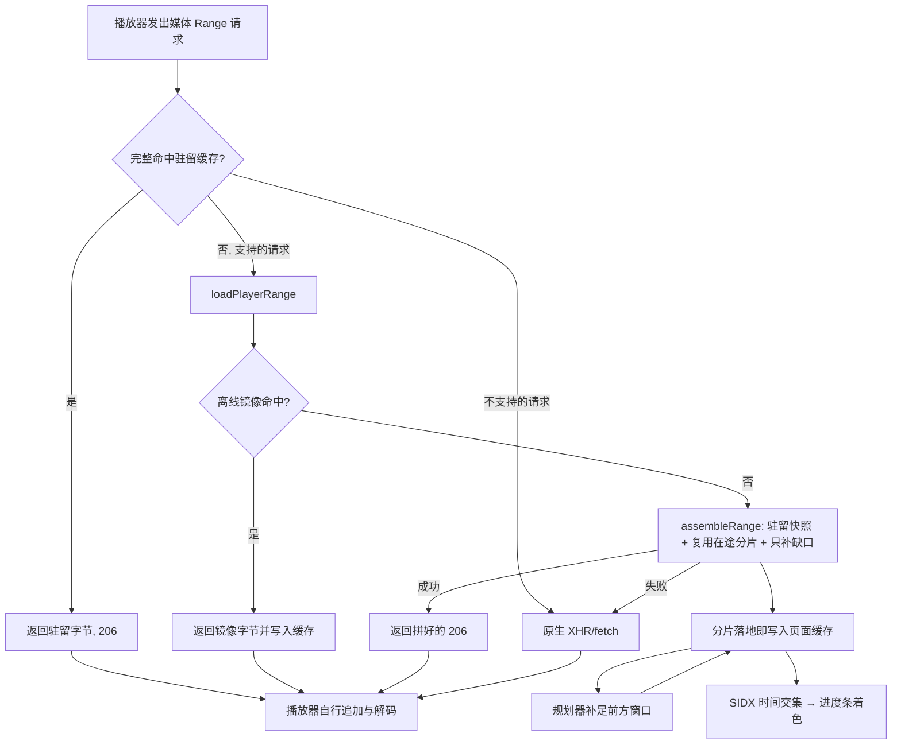

# 播放提前加载（在线）

> 适用版本：v2.16.0 · 最后核对：2026-10-27
> 对应实现：`src/playback-cache.js`、`src/playback-network.js`、`src/playback-reuse.js`、
> `src/playback-observer.js`（以上为 MAIN world，按此顺序注入）、`src/playback-bridge.js`（ISOLATED world）。

「提前加载」在用户观看时把播放器前方的分段先取回页面内存；播放器再请求同一段时，直接用这份数据回应。它不修改媒体编码，也不往播放器的 SourceBuffer 里追加数据，只替换播放器 XHR / fetch 的数据来源。

相关专题：

- [部分命中复用](partial-cache-reuse.md)：请求只有一部分在缓存里时怎么拼；
- [播放位置感知回收](playback-retention.md)：128 MiB 满了先丢哪些；
- [持久化源范围复用](persistent-range-reuse.md)：离线下载过的字节怎样服务在线播放；
- [下载工作内存](download-memory.md)：各环节的字节上限。

## 1. 模块与执行路径

| 文件 | 世界 | 职责 |
| --- | --- | --- |
| `playback-cache.js` | MAIN | 驻留字节、范围匹配、SIDX 与轨道类型解析、fetch / XHR 适配器 |
| `playback-network.js` | MAIN | 分片引擎：在途表、槽位、对冲、节点健康度 |
| `playback-reuse.js` | MAIN | 经隔离桥读取离线镜像的原始字节 |
| `playback-observer.js` | MAIN | 观察请求与 `<video>`、规划前方窗口、估计器保护、统计、进度条着色 |
| `playback-bridge.js` | ISOLATED | 转发配置、统计和复用读取；MAIN world 不能用 `chrome.storage` |

四个 MAIN 脚本都以 `run_at: document_start` 注入，早于多数播放器请求。它们包装页面的 XHR、fetch 和 Storage 原型：



## 2. 开关与启动条件

配置只有用户可见字段，存在 `chrome.storage.local["playbackAssistConfigV1"]`：

| 字段 | 默认 | 含义 |
| --- | --- | --- |
| `mode` | `always` | 提前加载开关；历史值 `auto` / `on` 读作开启，`off` / `observe` 读作关闭 |
| `progressColor` | `#00a1d6` | 进度条「已播放」颜色 |
| `showPreheatHighlight` | `true` | 是否单独标出提前加载 |
| `preheatColor` | `#ff8a1f` | 提前加载颜色 |

窗口秒数、并发、分片大小等网络策略都是页面侧常量，不进存储。历史存储里的 `cdnMode`、`maxConcurrency`、`leadSeconds`、`estimatorGuard` 等字段在 `sanitizeAssistConfig`（后台）和桥的 `normalizedConfig` 里一律丢弃。

开启后不等待「已播放 20 秒」「先出现慢请求」「页面在前台」等条件。只要满足以下几点就立即开始：

- 桥已把保存的开关下发为开启——MAIN 观察器在配置到达前保持内部 `pending`，避免明确关过的用户在页面刚打开时被默认值抢跑；
- 已经从播放器的首个 Range 请求（或观察到的 playurl 响应）拿到真实媒体 URL——插件不能在不知道本次 CDN、画质、编码和签名的情况下凭空请求；
- 该轨不在失败退避中（后台分片全部失败后按 2 → 4 → 8 → 15 秒退避，成功即清零）；
- 前方窗口、排队深度与槽位仍有余量。

关闭开关会取消预热、清空驻留缓存、停止估计器保护；观察器仍被动识别请求，以便再次开启。

## 3. 观察播放器请求

观察器只处理 B 站媒体 CDN（`bilivideo.com`、`bilivideo.cn`、`hdslb.com`、`akamaized.net`）且带 `Range` 的请求，记录 CDN 主机、路径、字节范围、响应启动延迟、正文吞吐、HTTP 状态与网络错误，以及 `<video>` 的播放余量与 `waiting` / `stalled` 事件。

统计按 `host + pathname` 归组；**正文缓存必须按完整 URL（含查询串）隔离**。同一路径的签名参数变化只沿用观察记录，不沿用旧正文或着色；换 CDN 主机同样需要当前 URL 自己的缓存。

### 3.1 高响应延迟

每个 CDN 节点独立计算阈值：

```text
高延迟阈值 = max(800 ms, 该节点正常响应启动延迟中位数 × 6)
```

超过阈值的播放器请求记为「高响应延迟请求」。这符合 CDN 回源的常见表现，但只能推断「疑似边缘未命中」，不是 CDN 内部状态的直接证据。

## 4. 前方窗口规划

规划由事件驱动：分片完成或失败、播放器请求、缓存写入、拖动（`seeking`）都会触发一次，另有 500 ms 定时器在播放位置推进后补位。

**有 SIDX 时**，选出与 `[播放位置, 播放位置 + 90 秒)` 相交的分段，字节总量封顶 96 MiB（给 128 MiB 页面缓存留出回看和播放器请求的余量），再加上文件头的初始化区；减去「已驻留」和「在途」的部分，剩下的就是缺口。每段带 `order = 段起始时间 − 播放位置`，音视频按同一时间轴交错排序，不会出现视频跑出很远、音频还没到的情况。

**还没有索引时**，先补初始化区与 SIDX：先探测 64 KiB，不够再扩到 1 MiB。

**索引不可用时**（非 DASH 或格式变化），才按平均码率从播放器最近一次请求的末端向后推进 `min(96 MiB, 总大小 ÷ 时长 × 90 秒)`，时长未知时取 24 MiB。这个估算只用于限制下载量，**不用于进度条着色**。

每次规划先取消「无人等待且已不在窗口内」的后台分片让出槽位，再把缺口补到排队深度 16。

| 常量 | 值 | 位置 |
| --- | --- | --- |
| 前方窗口 | 90 秒 | `LEAD_SECONDS` |
| 窗口字节上限 | 96 MiB | `AHEAD_BYTES_CAP` |
| 索引探测 | 64 KiB → 1 MiB | `INDEX_PROBES` |
| 后台排队深度 | 16 个分片 | `BACKGROUND_QUEUE` |

## 5. 分片引擎

所有在线下载都由 `src/playback-network.js` 完成。一个「分片」就是一次真实 Range 请求，正文按 `Content-Range`、长度和文件总长完整校验后才交付；总长必须是正的安全整数，并发未知总长响应在写缓存前还需与首个已完成分片确立的总长一致，交付时立即写入页面缓存。

- **同一张在途表**：播放器急需请求与后台预热共用按 URL 记录的在途分片，同一 URL 的在途分片互不重叠。急需请求碰到正在下载的后台分片就等待并复用它（同时升为急需优先级），不取消、不重下。
- **分片大小**：后台 512 KiB——海外节点首字节常在 0.5–2 秒，分片太小时首字节开销占满时间，太大则单个慢分片拖住整个窗口。急需请求拆成约 16 片并行，每片 64–512 KiB，缩短播放器等待。
- **槽位**：页面内信号量，普通尝试最多 32 个；急需备用/对冲另有 2 个救援槽，实际尝试峰值上限 34；后台准入最多占 12 个，给播放器请求留余量；排队时急需在前。不跨标签页协调。
- **对冲**：尝试拿到槽位后，首字节或正文停滞超过阈值时，在下一个候选地址（只有一个地址时为同一地址）并行发一份副本，先完成者胜、其余取消。原请求不会因为对冲被取消——它可能马上就要出字节。阈值为 `clamp(2 × 该地址首字节均值, 800 ms, 3 s)`，常态就慢的节点不会每片都被判慢。输掉的节点（阈值内一个字节都没出）短暂隔离 1 → 16 秒，并把卡住的时长计入首字节均值，避免它凭旧成绩一直排第一。
- **额外镜像**：只从 `upos-sz-mirrorcosov.bilivideo.com` / `upos-hz-mirrorakam.akamaized.net` 的 `/upgcxcode/*.m4s` 生成 `mirrorhw`、`mirrorali`、`mirroralib`、`mirrorhwb`。先使用当前清单主备；拿到原清单前 1 KiB（小文件取完整长度）后，慢/失败路径才探索镜像。该头可来自引擎下载、原生初始化驻留或已授权离线复用；观察器通过连续范围拷贝补齐身份，清单更换备用地址后也可重新建立。镜像总长与文件头需一致，校验任务单独占槽、同候选共享、最后一个等待者离开才取消。健康原线路不主动测速镜像；尚无原始身份时不探索；这不是整文件哈希校验。
- **备用停滞**：急需请求的备用尝试连续无进展达到两倍对冲阈值、且有下一候选时，取消该备用并轮换；首个原请求继续保留，持续出字节的连接不轮换。
- **清单修订**：每轮候选和校验固定使用同一份清单对象；清单更新后，旧轮次作废、限次重选，不把修订当成 CDN 故障。校验后、等槽后、正文读取后、写缓存前与拼装前均核对清单归属，移除的旧地址不能绕过镜像校验。
- **节点排序**：已测量的地址按「首字节 + 传 256 KiB 所需时间」排序，未测量的按清单顺序排在后面，由对冲和换节点自然探索到。
- **失败**：首字节 8 秒、正文停滞 4 秒判超时；失败地址按 1 → 16 秒指数退避隔离（403 隔离 60 秒），同一轮立即换下一个候选。后台分片最多 3 轮，急需分片 2 轮（播放器在等，应尽快交还原生请求）；每个急需范围还共享 12 秒总等待预算（含排队、镜像校验和重试）；超时取消只为它创建的分片并交还原生路径。最后一轮失败立即抛出，轮间退避（250 ms × 2ⁿ）可被取消打断。被取消（副本胜出、导航、播放器放弃）不计入节点故障。
- **播放器放弃**：只为这个请求新建的急需分片立即取消；后台分片（包括被预热规划接管的急需分片）恢复后台身份继续填窗口，不留空洞。

单次播放器请求最多 16 MiB。`assembleRange` 先检查请求是否已被取消（在复用查询的等待期间被取消的请求不会再派发 abort 事件），然后一次性分配响应缓冲：驻留部分用 `cache.copy` 直接写入，缺口由分片引擎写到对应偏移；网络分片以 `owned` 方式交给缓存，不再复制。任一缺口最终失败就取消其余缺口，整个请求回退原生，不把缺块伪装成成功。

## 6. 页面分段缓存

`src/playback-cache.js` 先于观察器注册，再由观察器安装请求适配器。

- **键**是完整 URL（含查询串），不跨签名、主机或清晰度共享。
- **写入**：预热分片必须是合法 206、Content-Range 匹配、正文完整；播放器自己的初始化响应可以复制进来（最多 1 MiB）用于解析头部，但标记为非插件数据。
- **容量**：驻留正文上限 128 MiB，按播放位置感知顺序回收（见[播放位置感知回收](playback-retention.md)）；最多保留 32 个资源。并发下载和命中响应另有短期副本，所以这不是整个标签页的内存上限。
- **正文只在页面内存**：不经 MAIN ↔ ISOLATED 消息传输，不写入离线片库，也不依赖 Service Worker 保活。
- **请求支持范围**：
  - fetch：GET 单段 Range、Request 对象、AbortSignal；
  - XHR：异步 GET + `responseType = "arraybuffer"`，提供 206 响应字段、2→3→4 状态变化、progress / load / loadend、取消和 `open` 重用；
  - 同步 XHR、其他响应类型、多范围 / 后缀范围、带 `If-Range` 或 `Authorization` 头的请求、`no-cors` 的 fetch、`open()` 传了用户名密码的 XHR，一律走原路径。
- **命中**返回原始媒体字节与正确的 `Content-Range` / `Content-Length`，不改编码。省掉下载时间不等于省掉解码时间，不承诺任意拖动零等待。
- **生命周期**：切换视频 / 分 P、关闭开关会清空缓存并取消预热，导航前的迟到响应不得重新填充；按实际播放器请求的序号选择当前音视频轨，旧请求晚完成不能夺回「当前轨」。

## 7. 进度条着色

### 7.1 字节如何对应时间

解析 ISO BMFF 的 SIDX v0 / v1：

```text
首段字节起点 = sidx 盒尾 + first_offset        （注意：相对 SIDX 盒尾，不是文件开头）
后续段起点   = 前一段起点 + 前一段 referenced_size
首段时间起点 = earliest_presentation_time / timescale
每段时长     = subsegment_duration / timescale
```

轨道类型从初始化段 `moov/trak/mdia/hdlr` 的 `vide` / `soun` 判断，不靠文件大小猜。索引越界、截断、层级引用或未知格式时不着色；没有 SIDX 的普通 progressive MP4 也不着色。

### 7.2 一段时间什么时候着色

1. 该轨初始化区仍完整驻留；
2. 该媒体段完整驻留，且字节由插件取得（后台预热、急需代下或离线复用），不是复制来的播放器初始化响应；
3. SIDX 给出了真实起止秒数；
4. 视频轨与音频轨的就绪秒数取交集。

交集再除以实际 `video.duration`，投影到进度条。可变码率不会让字节比例和时间比例混淆。

### 7.3 绘制规则

- 未播放区域的优先级：**提前加载色 > 播放器原生灰色 > 空白**；已播放颜色优先于两者。所以原生缓冲追上来时，提前加载色仍然保留。
- 回收、关闭或导航使缓存失效时撤销相应着色，着色不是永久的下载记录。
- 多段（章节）进度条按各段可见宽度投影；只修改未播放的背景，B 站原生的已播放节点、滑块、事件处理器都不替换，也不创建替代拖动控件。
- 关闭「单独标出提前加载」只是把这一色段画成灰色，不停止预热。
- 进度条按帧重绘（隐藏标签页不画）；驻留、轨道和时长都没变时复用上次的交集结果。

## 8. 播放器网络能力估计保护

B 站播放器把历史网络能力估计写在：

```text
localStorage["bilibili_dash_throughput_lru_v1"]
```

一次回源产生的极低样本会让播放器之后长期压低自动画质。插件不用固定下限，而是按同一 CDN 节点建立本机基线：

1. 收集该节点正常完成请求的正文吞吐，至少 3 个样本；
2. 动态下限 = `clamp(P25 × 55%, 1 000, 12 000) Kbps`；
3. 只有该节点**最近 15 秒内**出现过高响应延迟时，才过滤低于下限的样本；
4. 重算 P25、P50，把过低的 EWMA 提到下限，把过高的 latency 压到 `clamp(该节点 P95 首字节 × 3, 200, 1 000) ms`；
5. 其他主机、其他键和无法解析的数据原样保留。

这是针对播放器内部存储结构的启发式保护，不是 B 站的公开 API，页面结构变化后可能失效，因此所有修改都保守地限定在同一主机。它随提前加载开关一起启用，没有单独开关。

## 9. 统计契约

观察器每秒经 `window.postMessage` 把 `publicStats()` 发给隔离桥（`page->ext` / `stats`），弹窗通过 `GET_ASSIST_STATE` 读取。消息只含聚合数字和主机名，不含媒体字节、完整 URL 或 Cookie。

| 字段 | 含义 |
| --- | --- |
| `networkSpeed` | 急需与预热接收速度（B/s，时间平滑），对冲副本的字节也计入 |
| `networkActive` / `networkLimit` / `networkQueued` | 在途尝试数 / 槽位上限 34（普通 32 + 救援 2）/ 排队尝试数 |
| `networkHost` | 最近完成下载的 CDN 主机名 |
| `networkRescues` | 对冲副本胜出次数（普通的失败换节点不计） |
| `acceleratedRequests` / `acceleratedMB` | 由插件完成的播放器请求 |
| `nativeFallbacks` | 交还原生请求的次数 |
| `blockedNodes` | 当前被隔离的节点数 |
| `prefetching` / `prefetchMB` / `prefetchErrors` | 后台预热在途数、字节、失败数 |
| `prefetchAheadSec` | 从当前位置起连续着色的秒数（界面「已就绪」） |
| `cacheHits` / `cacheHitMB` | 完整命中 + 部分命中复用的次数与字节（界面「已命中」） |
| `cacheResidentMB` | 当前驻留字节（界面「缓存占用 / 128 MB」） |
| `reuseHits` / `reuseMB` | 离线镜像命中，单列，不计入 CDN 吞吐与节点健康度 |
| `bufferAheadSec` | 播放器自己的 `video.buffered` 余量 |
| `stalls` / `stallMs` | 卡顿次数与累计时长 |
| `requests` / `slowRequests` / `requestErrors` / `hosts` | 原始观察数据，`hosts` 含每节点 P50 / P95 首字节，供诊断，弹窗不展示 |

缓存命中不作为 CDN 吞吐样本。弹窗只采用 5 秒内的统计，过期时显示「等待视频播放」。

## 10. 验证

| 覆盖 | 位置 |
| --- | --- |
| 范围拼接、开放结尾、缺口、容量、SIDX v0/v1、非等码率、非法索引 | `tests/playback-cache.test.mjs` |
| fetch 失败 / 取消 / 导航 | `tests/playback-cache-fetch.test.mjs` |
| 分片拆分、槽位、复用在途、放弃、对冲、停滞、校验失败、拖动、reset | `tests/playback-network.test.mjs` |
| 窗口、字节封顶、音视频交错、换清晰度、拖动补位、着色优先级、旧配置字段忽略 | `tests/playback-observer.test.mjs` |
| 注入顺序与清单一致 | `tests/playback-registration.test.mjs` |
| 文档不得残留旧说法 | `tests/playback-documentation.test.mjs` |
| 真实 Chromium：AVC/AAC 两分片夹具由真实调度器预热，fetch/XHR 驱动双轨 MediaSource 播放、拖到第二片，检查零网络命中、原生事件与布局 | `npm run test:playback` |
| 受控网络延迟与需求响应 | `npm run test:network` |
| 生产 manifest 注入、热重载生效（标记 + SHA-256） | `npm run test:extension` |

受控网络（180 ms 延迟）的参考结果：冷路径约 203 ms，fetch / XHR 缓存命中约 13 / 15 ms，均解码 38 帧。这些是本地夹具数字，不是 B 站实际线路或任意视频的性能承诺。

## 11. 验证与适用边界补充

内容脚本同时覆盖普通视频/列表页与语言前缀页面，如 `/zh-Hans/video/`。`npm run test:cdn` 在真实 Chromium 中对照 2.15.0 调度器与当前调度器，但网络条件受控注入；`npm run test:live:playback -- --fail-originals` 在匿名真实视频页面阻断原清单域后 seek，让镜像仍直连真实 CDN，验证恢复。结果与限制见[本次验收](../research/2026-10-26-cdn-recovery-validation.md)。并非所有线路、画质和场景都更快；全线路故障时额外探索会增加少量请求和等待。

2026-10-27 边界复核与修复记录见 [CDN 续审](../research/2026-10-27-cdn-review.md)。无 SIDX 的平均码率窗口向下取整为字节；离线复用的迟到命中在取消、导航或关闭后重开时必须废弃，不能回填缓存或镜像身份。
