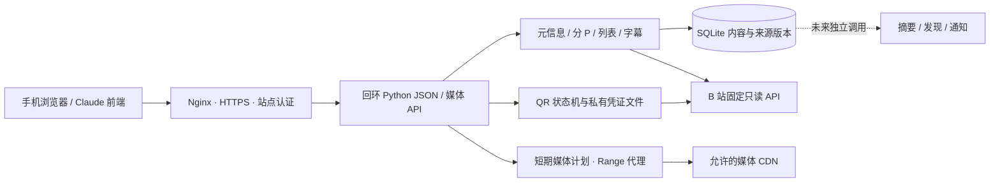

# 内容服务架构与技术决策

适用版本：0.1.0；最后核对：2026-10-27（Asia/Tokyo）。范围依据见 [PROJECT.md](PROJECT.md)。

虚线模块尚未部署。Chrome 扩展的 Service Worker、offscreen、IndexedDB 缓存与此服务并列，当前没有互通桥梁。

## 代码与存储边界

| 模块 | 责任 | 不承担 |
| --- | --- | --- |
| bilibili.py | 固定 API 白名单、WBI、元信息、字幕与取流请求 | UI、推荐、全站任意请求代理 |
| credentials.py / qrlogin.py | 本机登录态、owner 绑定 QR、校验后保存、注销 | 手机独立 B 站 Cookie、账号多租户管理 |
| library.py | 原始稍后列表、完整分页替换、分 P、字幕合并与采集状态 | 将 AI 筛选结果替换原始列表 |
| store.py / schema.py | SQLite 内容事实、revision、fingerprint、本地访问规则 | 模型结论或观看事件 |
| playback.py | 账号范围内 MP4 取流、内存令牌、Range/HEAD、过期与身份校验 | 完整下载、转码、DASH 合成 |
| server.py / cli.py | 请求验证、JSON 错误、HTTP/CLI 契约 | HTML 页面、播放器控件、后台任务队列 |

SQLite 表为 works、rules、library_state、library_entries、subtitle_state。每个 HTTP 请求单独连接；列表替换和证据合并使用事务，嵌套写入用保存点。失败分页只更新同步状态，保留上次完整队列；原始缺元信息/失效条目仍可显示。直接解析视频只存内容，不制造稍后再看成员关系。

单 P ID 通常为 BV 号，多 P 为 `BV...:pN`；family_id 指向 BV。CID 是媒体与字幕身份依据，不能用主 P 的字幕服务其他 P。CID 变化移除旧字幕证据。revision/fingerprint 覆盖采集到的内容事实，统计计数不参与指纹；不保证识别没有取得证据的媒体内部编辑。当前未实现内容历史版本查询和数据库迁移框架。

## 技术选择与代价

- **Python 3.11+ 标准库 + SQLite**：无运行时第三方依赖，适配树莓派既有 Python/systemd；适合单用户少量请求。同步接口可能等待上游，暂无持久化任务队列、全局并发调度或负载验收。
- **先提供单段 MP4**：优先建立浏览器可消费的简单媒体路径。请求质量和实际质量分开；无法取得该格式明确返回错误。HLS/ffmpeg/MSE/DASH 都不是当前隐藏回退。
- **薄前端与获取模块分离**：前端只消费规范化事实和短期媒体地址，不依赖 B 站 DOM；获取服务不内置 Claude 或其他模型供应商，也不为模型持有站内写权限。
- **同仓、独立运行与版本**：server/content 自有服务版本，不因增加后端而改 Chrome 权限或商店包；bilibili-discovery 保留实验，正式获取逻辑以本目录为准，避免两个生产实现并行漂移。
- **同源 HTTPS + Nginx 认证**：现有服务器已有 Nginx/certbot，无需引入另一套网关；Basic 认证作为当前单用户入口，可由未来独立登录层替换，但不能把 B 站 QR 当成网站访问认证。

## 请求与安全约束

后端仅监听回环 Host，代理设置 `Host: 127.0.0.1:18711` 并保留 Origin；生产 Origin 精确为 https://bilibili.kihara.cn。bd_client 是 QR 尝试 owner Cookie，不是访问网站的认证凭据。部署 HTTPS 时带 Secure/HttpOnly/SameSite=Strict，不能把它写成持久 B 站登录态。

B 站账号 Cookie 只发固定 API 域；字幕和媒体 CDN 不带账号 Cookie。临时 CDN URL 只保留内存，客户端看到不透明媒体令牌。媒体/字幕 URL 限域、禁止重定向；返回 HTML 不得以同源媒体转给浏览器。每次打开媒体检查当前可访问性、屏蔽规则和 CID，注销会使旧计划失效。

上游 HTTP JSON 超时 20 秒，响应上限 8 MiB；单个 transport 实例内请求间隔 0.7 秒。此间隔不是全局并发限流。遇到风控/验证票据停止，不通过换身份或高频重试绕过。API JSON 请求体上限 2 MiB。QR 每 owner 绑定、至少 2 秒轮询、180 秒超时；媒体计划最多 128 个、最长约 600 秒，均不跨进程重启保留。

本地数据库及账号状态为持久私有数据；注销只清登录文件和媒体计划，不等于清空已采集的队列/字幕。只有一个共享服务端 B 站账号槽位，站点密码持有者拥有同一资料访问能力；当前不提供按手机隔离或多用户权限。

## 部署与证明边界

rasp5remote 使用 Nginx → 127.0.0.1:18711 → systemd DynamicUser 服务；代码在 /opt，状态在 /var/lib，详细路径和回滚见 [deploy/README.md](deploy/README.md)。不把本机个人数据库、浏览器会话或原型报告同步过去。

2026-10-27 的验证为 57 项本地/远端测试和真实公共 HTTPS 视频 Range/HEAD、QR 未扫码流程。认证用户成功扫码、完整账号库、iPhone AV 播放、后台播放或通知属于独立验收项，不能由这些测试推出。
