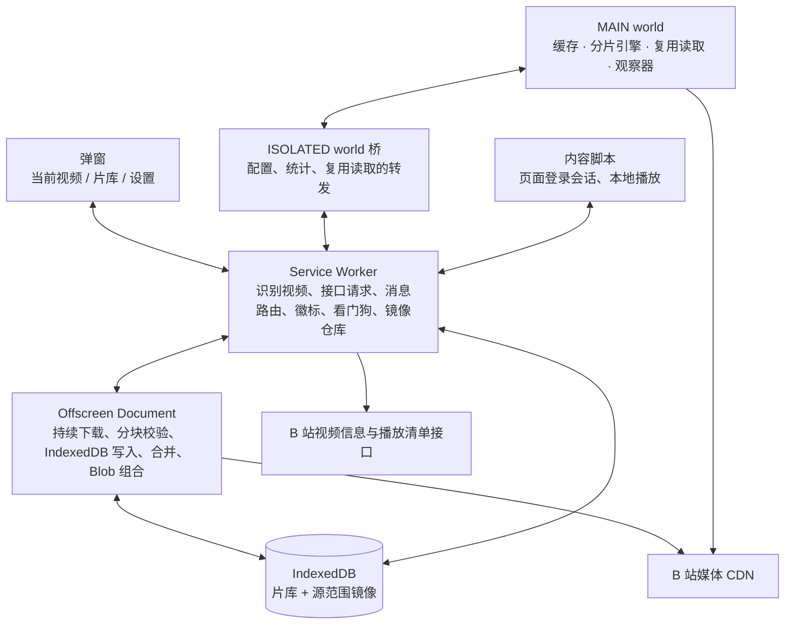

# 海内存知技术文档

> 适用版本：v2.12.6
> 最后核对：2026-10-24（逐条对照源码）
> 本文是总览：系统边界、运行架构、消息契约、存储、权限、术语与已知边界。各功能的细节在 [docs/](docs/README.md) 下的专题文档里；
> 每个版本改了什么见[开发日志](开发日志.md)。

## 怎么读

| 想了解 | 去看 |
| --- | --- |
| 整体怎么跑、各上下文之间传什么 | 本文第 2–4 节 |
| 完整缓存：识别、选轨、下载、续传、合并、本地播放、保存 | [完整缓存](docs/architecture/offline-cache.md) |
| 提前加载：规划、分片引擎、页面缓存、进度条着色、估计器保护 | [播放提前加载](docs/architecture/playback-assist.md) |
| 弹窗的结构与实时刷新规则 | [弹窗](docs/architecture/popup.md) |
| 热更新、构建、上架合规、官网 | [热更新、构建与发布](docs/development/build-and-release.md) |
| 测试分层与命令 | [测试与验收](docs/development/testing.md) |
| 某个设计当初为什么这样选 | [docs/history/](docs/README.md#历史记录) |

## 1. 目标与边界

海内存知解决海外观看 B 站时的两类需求：

1. **降低在线播放的等待**：观察播放器实际请求的媒体范围，提前把前方分段取回页面内存；播放器 XHR / fetch 命中时直接返回这些字节。
2. **完整保存视频**：把当前账号实际可访问的媒体轨完整下载进扩展的 IndexedDB，之后在原播放器里本地播放，或保存成文件。

两条路线互补，但数据位置、生命周期和可靠性完全不同，不能混为同一种「缓存」。

### 1.1 四种缓存

| 类型 | 数据位置 | 生命周期 | 在本项目中的作用 |
| --- | --- | --- | --- |
| 播放器缓冲 | B 站页面内存（`video.buffered`） | 刷新或关闭页面即消失 | 播放器自己的连续播放余量；进度条上的原生灰色 |
| 页面分段缓存 | 当前页面 MAIN world 内存，上限 128 MiB | 回收、关闭开关、切换视频或刷新页面即消失 | 「提前加载」取回的字节，供播放器请求复用；SIDX 确认的音视频交集在进度条上着色 |
| CDN 边缘缓存 | 离用户较近的 CDN 服务器 | 由 CDN 决定 | 可能减少回源，但插件看不到它，不作为着色依据 |
| 离线片库 | 扩展的 IndexedDB | 重载、重启后仍在；卸载扩展或清除扩展存储即删除 | 完整缓存、本地播放、断点续传、保存文件 |

进度条上的提前加载色只表示对应数据驻留在页面分段缓存里，不等于已追加到播放器的 SourceBuffer，也不是离线片库的记录；播放还需要解码，所以它不保证「这里一定不卡」。

### 1.2 不做的事

- 不转码：合并与提取都是重封装，字节与 CDN 原始轨道一致。
- 不绕过权限：登录态只使用账号已有的权益，不能绕过会员、付费、地区或版权限制。
- 不支持番剧、互动视频、课程和特殊多段格式。
- 没有服务器、分析或遥测。

## 2. 运行架构

项目是 Chrome Manifest V3 扩展，把界面、协调、长时间下载、页面观测和本地播放拆到不同的运行环境：

| 上下文 | 主要文件 | 职责 | 为什么在这里 |
| --- | --- | --- | --- |
| 弹窗 | `popup.html`、`popup.css`、`src/popup.js` | 展示与交互 | 关闭即销毁，只能做交互，不能持有下载 |
| Service Worker | `src/background.js` | 消息路由；解析视频、请求视频信息与播放清单；创建 Offscreen；徽标；`chrome.alarms` 看门狗；弹窗快照；提前加载配置；源范围镜像仓库；运行期自检 | 扩展唯一常驻入口，但会被 Chrome 随时休眠 |
| Offscreen Document | `offscreen.html`、`src/offscreen.js` | 长时间 CDN 请求、Range 校验、原子写入、合并与提取、组合 Blob URL；开发态轮询热更新服务 | 没有界面，但比弹窗和 Service Worker 更适合持续持有网络连接 |
| MAIN world | `src/playback-cache.js` → `playback-network.js` → `playback-reuse.js` → `playback-observer.js` | 包装 XHR / fetch / Storage，观察请求，提前加载，着色，估计器保护 | 只有页面主世界能包装播放器自己的请求；`document_start` 注入，早于多数播放器请求 |
| ISOLATED world | `src/playback-bridge.js` | 读写 `chrome.storage`，在页面与扩展之间转发配置、统计和复用读取 | MAIN world 不能使用扩展 API |
| 内容脚本 | `src/content.js` | 用页面登录会话请求播放清单；把本地缓存应用到原 `<video>` | 需要页面的 Cookie 上下文和 DOM |

**MV3 生命周期的约束**：Service Worker 可能在任何时候休眠，所以任务状态一律写进 IndexedDB，弹窗快照写进 `chrome.storage.session`，定时恢复用 `chrome.alarms`，而不是依赖后台的全局变量或 `setTimeout`。徽标、片库排序等也都从数据库派生，SW 重启后可以完整恢复。

## 3. 消息契约

扩展内消息都带 `target`（`background` / `offscreen` / `popup`），Service Worker 只处理发给自己或没有 `target` 的消息。

### 3.1 弹窗 → Service Worker

| 消息 | 用途 |
| --- | --- |
| `GET_POPUP_SNAPSHOT` / `REFRESH_POPUP_DATA` / `SET_POPUP_SELECTION` | 读取 / 刷新 / 更新当前页的弹窗快照（存于 `storage.session`） |
| `GET_PAGE_INFO` / `GET_QUALITY_OPTIONS` | 当前页是否支持、视频信息、可选画质与体积 |
| `GET_CACHE_MODE` / `SET_CACHE_MODE` | 「视频 / 仅音频」偏好 |
| `GET_ASSIST_STATE` / `SET_ASSIST_CONFIG` | 提前加载配置与当前页统计 |
| `GET_HEALTH` | 运行期自检结论 |
| `START_CACHE` / `PAUSE_CACHE` / `RESUME_CACHE` / `DELETE_VIDEO` | 任务控制 |
| `LIST_VIDEOS` / `GET_VIDEO` / `SAVE_VIDEO` | 片库与保存 |

### 3.2 Service Worker ↔ Offscreen

| 方向 | 消息 | 用途 |
| --- | --- | --- |
| SW → Offscreen | `START_DOWNLOAD` / `PAUSE_DOWNLOAD` / `DELETE_VIDEO` | 启动、暂停、删除任务 |
| SW → Offscreen | `GET_ACTIVE_DOWNLOADS` / `LIST_VIDEOS` / `GET_VIDEO` / `GET_PLAYBACK_URL` | 查询与取本地播放 URL |
| Offscreen → SW | `CACHE_PROGRESS` / `CACHE_RETRY` / `CACHE_COMPLETE` / `CACHE_ERROR` / `CACHE_PAUSED` / `CACHE_DELETED` | 任务事件；SW 据此更新徽标并转发给弹窗，完成时通知原标签页 `CACHE_READY` |
| Offscreen → SW | `REFRESH_DOWNLOAD_SOURCE` | 签名过期或节点被拒时重新取播放地址 |
| Offscreen → SW | `SOURCE_RANGE`（`op: "write"`） | 写入源范围镜像 |

### 3.3 页面 ↔ 扩展

| 方向 | 消息 | 用途 |
| --- | --- | --- |
| SW → 内容脚本 | `BILI_BUFFER_FETCH_PLAYURL` | 用页面登录会话请求播放清单 |
| SW → 内容脚本 | `CACHE_READY` | 缓存完成，检查是否切换为本地播放 |
| 内容脚本 → SW | `GET_CACHED_FOR_URL` / `GET_PLAYBACK_URL` / `PLAYBACK_ACTIVE` | 找本地记录、取 Blob URL、显示「本地」徽标 |
| SW → 隔离桥 | `BILI_BUFFER_GET_ASSIST_STATE` / `BILI_BUFFER_SET_ASSIST_CONFIG` | 读当前页统计、改配置 |
| 隔离桥 → SW | `SOURCE_RANGE`（`op: "read"`） | 读源范围镜像 |
| 隔离桥 ↔ MAIN | `window.postMessage`，`channel: "bili-buffer-playback-assist-v1"` | `ext->page`：`config`、`reuseReply`；`page->ext`：`stats`（每秒）、`reuseRead` |

安全约束：

- `SOURCE_RANGE` 写入只接受扩展自己的 Offscreen 文档，读取只接受 B 站视频页（`sourceRangeScope`），其余来源直接拒绝；
- 桥只转发形状合法、只含白名单字段的请求，非法 `rpcId` 或缺字段的请求静默丢弃；
- 桥不转发 Cookie、签名媒体正文或完整网络响应；`stats` 只含聚合数字和主机名；
- 复用读取在页面侧 1.5 秒超时，桥对晚于 1.4 秒的回包直接给空结果。

## 4. 存储

### 4.1 IndexedDB

| 数据库 | 所在上下文 | 内容 |
| --- | --- | --- |
| `bili-buffer-cache`（版本 1） | Offscreen 负责下载写入；Service Worker 读取任务列表、更新任务状态 | `videos`：任务元数据；`chunks`：媒体分块，主键 `[videoId, track, index]`。详见[完整缓存 · IndexedDB](docs/architecture/offline-cache.md#33-indexeddb) |
| `bili-buffer-source-ranges-v1` | Service Worker | 离线下载校验过的原始 CDN 范围镜像，64 MiB / 256 行 / 跟随签名有效期。详见[持久化源范围复用](docs/architecture/persistent-range-reuse.md) |

这些名字在两次更名（影哨、海内存知）中刻意保持不变：改名即丢失用户的片库。

### 4.2 chrome.storage

| 键 | 区域 | 内容 |
| --- | --- | --- |
| `playbackAssistConfigV1` | local | 提前加载开关与颜色 |
| `cacheModeV1` | local | 「视频 / 仅音频」偏好 |
| `browserHealthV1` | local | 运行期自检结论（6 小时内复用） |
| `devReloadPendingRevisionV2` | local | 仅开发态：热更新交接标记 |
| `popupPageSnapshotsV1` | session | 各标签页的弹窗快照 |

页面侧还会修改 B 站播放器自己的 `localStorage["bilibili_dash_throughput_lru_v1"]`（见[估计器保护](docs/architecture/playback-assist.md#8-播放器网络能力估计保护)）。

## 5. 权限

| 权限 | 用途 |
| --- | --- |
| `activeTab` | 读取当前标签页地址，判断是否为支持的视频页；不用于读取页面内容或注入脚本 |
| `alarms` | 分钟级唤醒后台，恢复等待中的下载 |
| `cookies` | 只检查 B 站 `SESSDATA` 是否存在，并对它做不可逆摘要作为镜像的账户分区；不保存 Cookie 原文 |
| `declarativeNetRequestWithHostAccess` | 只为扩展自己发往 CDN 与接口的请求补 B 站 Referer |
| `downloads` | 把本地 Blob 保存为用户文件 |
| `offscreen` | 创建隐藏的下载文档 |
| `storage` | 保存配置、偏好、自检结论和弹窗快照 |
| `unlimitedStorage` | 降低大视频受普通扩展配额限制的风险 |
| B 站 / CDN 主机权限 | 请求视频信息、播放清单和媒体 Range；`http://127.0.0.1/*` 只用于开发态热更新，发布包会删除 |

扩展本地数据库为了续传会保存临时的签名 CDN 地址，但不保存 Cookie 原文，也不会发送给任何第三方。新增权限的流程见[构建与发布 · 权限最小化](docs/development/build-and-release.md#32-权限最小化)。

## 6. 关键数字速查

| 项 | 值 | 位置 |
| --- | --- | --- |
| 页面分段缓存上限 | 128 MiB，最多 32 个资源 | `playback-cache.js` |
| 提前加载前方窗口 | 90 秒，字节封顶 96 MiB | `playback-observer.js` |
| 在线槽位 | 全局 32，后台最多 12 | `playback-network.js` |
| 在线分片 | 后台 512 KiB；急需约 16 片、每片 64–512 KiB | `playback-network.js` |
| 在线超时 | 首字节 8 秒、正文停滞 4 秒；对冲阈值 0.8–3 秒 | `playback-network.js` |
| 单次播放器请求 | 最多 16 MiB | `playback-observer.js` |
| 离线分块 | 2 MiB；视频 6 路、音频 2 路；每轨窗口 16 MiB | `range-downloader.js`、`offscreen.js` |
| 离线停滞超时 | 20 秒无新字节 | `range-downloader.js` |
| 离线任务内续传 | 2 / 5 / 15 / 30 / 60 秒 | `offscreen.js` |
| 看门狗 | 1 / 2 / 5 分钟，之后每 5 分钟，无次数上限 | `download-retry.js` |
| 合并输出分块 | 4 MiB | `offscreen.js` |

## 7. 术语

| 术语 | 含义 |
| --- | --- |
| **提前加载**（代码：prefetch / preheat） | 插件提前请求播放器前方的分段，存入有上限的页面内存；与离线片库无关 |
| **急需请求** / **后台预热** | 播放器正在等的请求 / 插件为前方窗口主动发的请求；两者共用分片引擎的在途表 |
| **对冲**（界面：救援） | 节点停滞时在备用地址并行发一份副本，先完成者胜 |
| **完整命中** / **部分命中** | 请求范围全部驻留，直接返回 / 部分驻留，只补缺口后拼成完整响应 |
| **播放余量**（界面：播放器缓冲；代码：`bufferAheadSec`） | 从当前位置起 `video.buffered` 还能连续播放多少秒；不是插件缓存大小 |
| **已就绪**（代码：`prefetchAheadSec`） | 从当前位置起连续着色的秒数 |
| **高响应延迟请求**（旧称慢请求） | 响应启动延迟超过 `max(800 ms, 同节点中位数 × 6)` 的播放器请求；不等于总速度慢，也不必然卡顿 |
| **疑似边缘未命中**（旧称冷区间） | 响应启动明显偏慢、可能需要 CDN 回源的范围；只能从现象推断 |
| **TTFB**（代码：`ttfb`） | 首字节时间；实际测量的是从发出请求到拿到响应头，更准确的叫法是「响应启动延迟」 |
| **P25 / P50 / P95** | 第 25 / 50 / 95 百分位；P50 即中位数 |
| **EWMA** | 指数加权移动平均，新样本权重更高 |
| **SIDX** | ISO BMFF 的分段索引盒，给出每个分段的字节位置与真实时长；进度条着色和按时间规划都依赖它 |
| **重封装（remux）** | 只改变容器与轨道组织，不重新编码样本；合并与提取音轨都属于此类 |
| **DASH** / **progressive** | 音视频分轨、按清晰度和编码拆开的流 / 音视频在同一个文件里的单段 MP4 |
| **确认落盘**（`committedBytes`） | IndexedDB 事务成功后才提高的水位，界面「已缓存」以它为准 |

吞吐是某次请求实际取得数据的速度，带宽是链路的传输能力，码率是媒体每秒需要的数据量；三者不能互相替代。

## 8. 已知边界

**提前加载**

- 预取会产生额外流量；缺口、回收、URL 变化或不支持的请求仍会走网络。
- 着色只用 SIDX 的真实时间交集：索引未知、损坏、层级引用或单轨不完整时不着色；没有 SIDX 的 progressive MP4 不着色。
- 多段（章节）进度条按各段可见宽度推算时长占比；B 站以后若改成非时长比例的宽度，需要重新适配。
- CDN 可能切换节点、淘汰数据或让签名失效。低首字节但正文吞吐不足时仍可能卡顿。
- 估计器保护依赖 B 站内部的 localStorage 结构，不是稳定的公开 API。
- 已知总长时，每个播放器请求都会先查询一次离线镜像（最多等 1.5 秒；连续 3 次失败后暂停 60 秒）。
- 本地命中是否会推高 B 站的自动画质尚未验证。

**完整缓存**

- 视频与音频的体积互相独立：无损音轨（1.4–1.8 Mbps）常比低码率画面大几倍，视频字节数小不等于档位低。
- Hi-Res 无损是 MP4 容器 + FLAC 编码，保存为 `.flac` 是按编码命名，容器仍是 MP4。
- 合并只支持 fragmented MP4（`moov` 内含 `mvex`）；其他布局保留双轨并提示未合并。合并要完整读一遍源分块、写一份新文件，长视频在这一步会有额外磁盘读写和短暂的进度停顿。
- 单段 MP4 的「仅音频」要先下载整段视频再提取，这一次的流量等于整段视频。提取只支持标准 `stbl` 布局，样本表不一致或文件截断时报错并保留整段 MP4。
- 仅音频记录不参与网页自动本地播放；合并失败时的双轨回退需要把完整轨道重新组合进页面内存。
- 卸载扩展或清除扩展存储会删除片库。

**工程**

- `src/offscreen.js` 里的 `fetchDashTrackAndStore` / `fetchDashTrackCandidate`（约 135 行）已无调用方，待删除。
- 弹窗在用户真实工具栏里的手动验收、真实 CDN 上的完整 4K / Hi-Res 下载、Windows 与第三方播放器对合并文件的兼容性，都没有自动化覆盖。

## 9. 与参考项目的关系

参考 BiliLoader 的思路：海外 CDN 边缘未命中的诊断；用前置 Range 请求促使 CDN 回源；关注响应启动延迟而不只看正文速度；防止单次高延迟样本长期污染播放器网络估计；CDN 节点的可观测指标。

本项目独立实现：完整视频本地缓存；当前账号最高画质与编码选择；DASH 双轨下载与浏览器内重封装；IndexedDB 分块与原子续传；节点测速、并发 Range 与动态回退；地址失效自动刷新与关闭页面后的持续续传；片库、保存与删除；原播放器中的本地播放；页面内存缓存与分片引擎；开发态热更新和发布包剥离。

2.8.x 的大陆 CDN 候选表与线路选择曾参考 Bilibili-thread-ripper（MIT）；2.9.0 起该候选表已移除，在线下载只使用播放清单自带的主备地址。来源与许可见 [THIRD_PARTY_NOTICES.md](THIRD_PARTY_NOTICES.md)。

## 10. 源码索引

| 模块 | 文件 |
| --- | --- |
| Manifest 与 DNR 规则 | `manifest.json`、`rules/cdn-headers.json` |
| 弹窗 | `popup.html`、`popup.css`、`src/popup.js`、`src/task-presentation.js`、`src/popup-snapshot.js`、`src/cache-size.js` |
| 后台协调 | `src/background.js` |
| 持续下载与本地播放数据 | `src/offscreen.js`、`offscreen.html` |
| Range 下载 | `src/range-downloader.js` |
| 自动续传 | `src/download-retry.js` |
| 片库数据库 | `src/db.js` |
| 重封装与音轨提取 | `src/mp4-merge.js` |
| 画质、编码、音轨选择与通用校验 | `src/utils.js`、`src/media-selection.js` |
| 源范围镜像 | `src/source-range-store.js`、`src/source-mirror.js`、`src/playback-reuse.js` |
| 页面缓存、分片引擎、观察器 | `src/playback-cache.js`、`src/playback-network.js`、`src/playback-observer.js` |
| 页面 / 扩展桥 | `src/playback-bridge.js` |
| 页面登录会话与本地播放 | `src/content.js` |
| 提前加载配置 | `src/assist-config.js` |
| 运行期自检 | `src/health-check.js` |
| 开发热更新 | `src/dev-reload.js`、`scripts/dev-reload-server.mjs` |
| 构建、校验、打包 | `scripts/build-release.mjs`、`scripts/verify-release.mjs`、`scripts/lib/release-checks.mjs`、`scripts/lib/zip.mjs`、`scripts/check-syntax.mjs` |
| Chrome 版本门禁 | `browser-compat.json`、`scripts/check-browser-compat.mjs`、`scripts/test-chrome.mjs`、`scripts/lib/browser-compat.mjs`、`scripts/lib/browser-launch.mjs` |
| 图标、商店素材、官网 | `scripts/build-icons.mjs`、`scripts/store-assets.mjs`、`store/scene/`、`scripts/build-site.mjs`、`site/` |
| 隐私政策与提审资料 | `privacy.html`、`store/listing.md`、`store/README.md` |
